<div align="center">

# 作业HW1实验报告

姓名：于沛可 学号：2451951 日期：2025年10月7日
</div>

---

## 1. 涉及数据结构和相关背景

**线性表：**

线性表用于存储一组有序的元素。线性表的元素具有顺序性和线性关系。它通过节点存储线性表的元素，节点包含数据部分和指向下一个节点的指针。线性表支持动态大小的插入和删除操作。

线性表一般分为顺序表和链表。

**顺序表**

* 定义：使用连续的内存空间存储元素。
* 优点：
    * 支持快速随机访问（通过索引计算地址）。
    * 存储密度高（没有额外的指针开销）。
* 缺点：
    * 插入和删除操作慢，因为需要移动大量元素以保持连续性。
    * 扩容时（如数组空间不足）可能需要重新分配和复制整个数组，导致性能下降。

**链表**

* 定义：由多个节点组成，每个节点包含数据部分和指向下一个节点的指针。
* 优点：
    * 插入和删除操作高效（只需修改指针，时间复杂度为 $O(1)$）。
    * 不需要连续内存，内存利用灵活。
* 缺点：
    * 随机访问较慢，必须从头节点开始遍历才能访问到特定元素。
    * 需要额外的指针空间来存储地址，可能导致存储浪费（存储密度低）。

---

## 2.实验内容

## 实验一：轮转数组

### 2.1.1 问题描述  
给定一个整数顺序表nums，将顺序表中的元素向右轮转k个位置，其中k是非负数。  

---

### 2.1.2 基本要求  
**输入：**  
- 第一行：两个整数n和k，分别表示nums的元素个数和向右轮转的步数；  
- 第二行n个整数，表示顺序表nums的元素。  

**输出：**  
- 轮转后的顺序表。  


1. 实现数组的右移轮转。  
2. 尽可能想出三种不同的方法，并分析时间复杂度与空间复杂度。  
3. 思考是否能用空间复杂度 O(1) 的原地算法解决。  

---

### 2.1.3 数据结构设计  
本题采用顺序表（数组）存储数据：

```cpp
// 使用顺序表存储数据
vector<int> arr; // 存储输入的整数序列
```
---

### 2.1.4 功能说明  

#### 方法一：两次循环迭代（暴力法）  
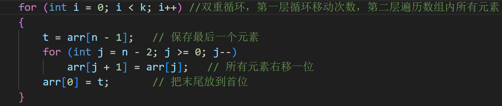
时间复杂度：O(n * k)
空间复杂度：此方法只用了一个额外的 temp 变量来临时存储最后一个元素的值，因此输入O(1)，为原地算法。

#### 方法二：创建额外数组  
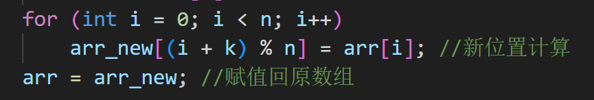
时间复杂度：O(n)
空间复杂度：此方法创建了一个同等大小为n的数组，额外开销为n，空间复杂度为O(n)
第二种方法虽然较第一种在时间复杂度上大大减小，但是增加了空间开销，因此思考：有无一种同时实现时间与空间复杂度较优的算法？
#### 方法三：使用reverse函数  
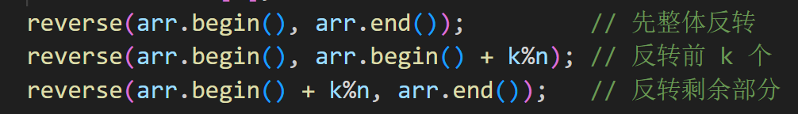
时间复杂度：O(n+k+(n-k))=O(n)
空间复杂度：由于只使用了有限个变量来进行元素交换，因此，空间复杂度是 O(1)，属于原地算法。
由此可见，方法三同时实现时间与空间复杂度的较优解。

---

### 2.1.5 调试分析  

1. **方法一**：数据量较大时会超时。  
2. **方法二**：运行高效，但使用了额外数组。
3. **方法三**：原地操作，效率最高
  但是我第一次测试只拿到了 60 分，因为没有对 k 取模，导致当 k > n时反转区间出错。修复方法：在执行反转前先 k %= n;。  

---

### 2.1.6 总结与体会  
- 使用一题多解：暴力法、额外数组法、三次反转法。  
- 本题在算法设计时要特别注意边界情况，比如 k = 0、k = n、k > n。  

---


## 实验二：学生信息管理

### 2.2.1 问题描述

本题要求定义一个包含学生信息（学号、姓名）的顺序表，并实现如下功能：

1. 根据指定学生个数，逐个输入学生信息；
2. 给定一个学生信息，插入到表中指定的位置；
3. 删除指定位置的学生记录；
4. 分别根据姓名和学号进行查找，返回该学生的信息；
5. 统计表中学生个数。

---

### 2.2.2 基本要求
**输入：**

* 第 1 行：一个整数n，表示学生总数；
* 接下来的n行：每行输入一名学生的学号*与姓名；
* 若干行操作，包括：

  * insert i 学号 姓名
  * remove j
  * check name 姓名y
  * check no 学号x
  * end（表示结束操作）。

**输出：**

* 对于每个操作，按要求输出执行结果；
* 最后一行输出当前学生总数。
---

### 2.2.3 数据结构设计

本题采用结构体数组作为顺序表的存储方式：
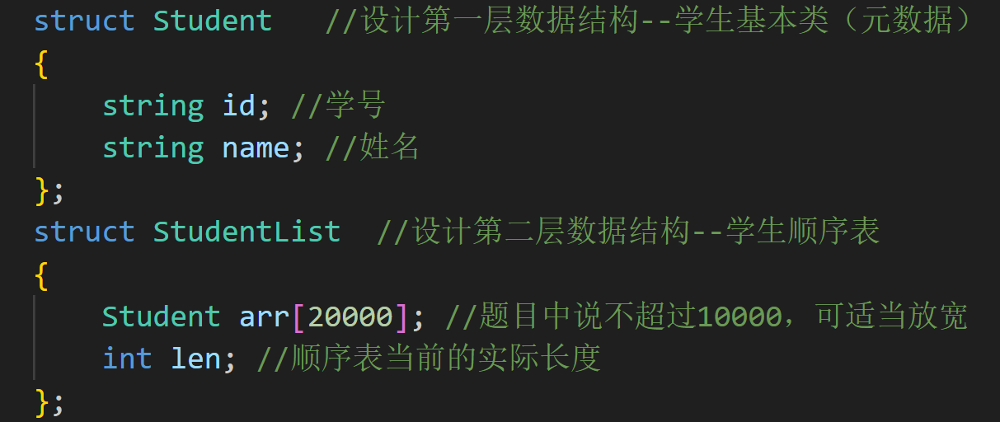

### 2.2.4 功能说明

#### 插入操作
```cpp
@brief   插入学生信息
@param i 要插入的位置（从1开始计算）
@param list 指向 StudentList 结构体的指针
@param stu_id 待插入学生的学号
@param stu_name 待插入学生的姓名
@return int 0 表示插入成功，-1 表示插入失败    
```
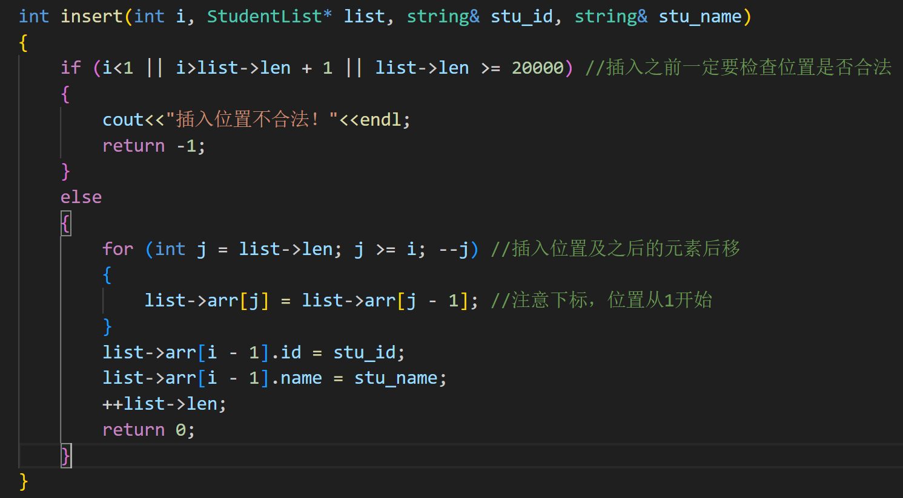

#### 删除操作
```cpp
@brief 在指定位置删除一个学生记录
@param i 要删除的位置（从1开始）
@param list 指向 StudentList 结构体的指针
@return int 0 表示删除成功，-1 表示删除失败
```
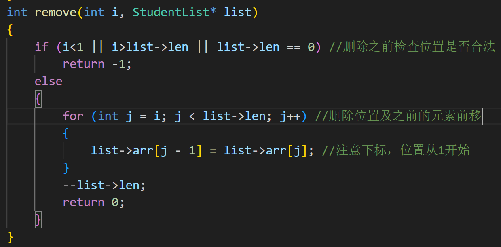

#### 查找操作
```cpp
@brief 按照姓名查找学生记录并输出其位置、学号和姓名。
@param list 指向 StudentList 结构体的指针
@param y 要查找的学生的姓名。
@return void 函数通过标准输出打印结果
```
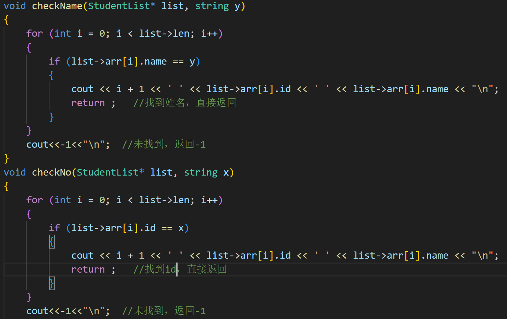
---

---
### 2.2.5 调试分析

1. **数据边界处理**：
   * 起初arr容量设置为10000，导致有一半测试点无法通过，后续适当扩大问题解决
   * 插入与删除操作应注意对位置不合法情况的处理
2. **内存分配**：起初使用malloc函数初始化list:
```cpp
StudentList* list = (StudentList*)malloc(sizeof(StudentList));
```
导致程序崩溃

**原因分析**
malloc只分配原始字节内存，不会调用构造函数。而string内部依赖构造函数初始化（分配空间、设置指针、长度等），因此list->name和list->id在malloc后是野指针，一旦赋值会导致未定义行为行为  

**正确写法**
```cpp
StudentList* list = new StudentList;   // 安全，string 自动初始化为空
list->name = "Alice";                  // 正常使用
delete list;                           // 自动调用析构，释放 string 内存
```

malloc函数仅限于 POD 类型（int, char, struct 无构造函数）
使用new方法可以用于C++ 类对象（含 string、vector、STL 容器等） 

---


### 2.2.6 总结与体会

通过本实验，我对顺序表的基本操作有了更加直观和深入的理解。在实现过程中主要有以下几点收获与体会：

1. **对顺序表的认识**

   * 顺序表是一种基于数组的线性存储结构，具有随机访问快、空间连续的优点。
   * 但插入与删除操作需要移动大量元素，时间复杂度为 O(n)，在数据量较大时效率较低。

2. **实现过程中的难点**
   * 下标混淆：题目要求元素位置从 1 开始，而数组索引从 0 开始，容易出错。
   * 插入删除方向错误：移动元素时必须从尾到头（插入）、从头到尾（删除），否则会覆盖数据。
   * 容量设置不足：题目要求最大 10000 个元素，若数组空间不足会导致溢出。

---


## 实验三：一元多项式的相加和相乘

### 2.3.1 问题描述

一元多项式是有序线性表的典型应用。
我们用一个线性表 ((p1,e1),(p2,e2),...(pm,em)) 表示多项式，每个元素包含系数和指数。

本题要求：

1. 输入两个多项式（保证指数递增有序）；
2. 实现多项式的加法和乘法；
3. 结果按指数从小到大输出，若系数为 0 则不输出。

---

### 2.3.2 基本要求

**输入：**

* 第 1 行：整数 m，表示第一个多项式的项数；
* 第 2 行：2m 个整数，表示多项式的系数和指数；
* 第 3 行：整数 n，表示第二个多项式的项数；
* 第 4 行：2n 个整数，表示第二个多项式的系数和指数；
* 第 5 行：整数 op，若为 0 输出加法结果，若为 1 输出乘法结果，若为 2 输出加法与乘法各一行。

**输出：**

* 运算结果的多项式链表，指数升序排列；
* 系数为 0 的项不输出。

---

### 2.3.3 数据结构设计

采用单链表存储多项式：

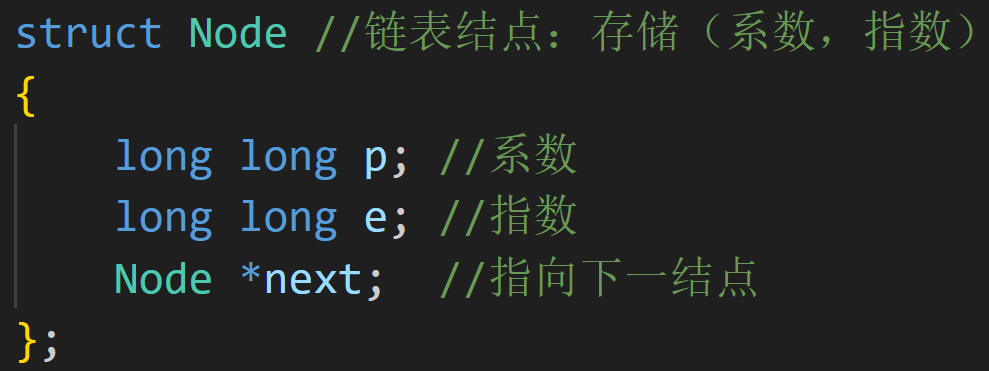

---

### 2.3.4 功能说明

#### （1）多项式加法
```cpp
@brief 计算两个多项式链表的和，采用双指针法
@param p1 第一个多项式链表的头指针
@param p2 第二个多项式链表的头指针
@return Node* 指向结果多项式链表的头指针
```
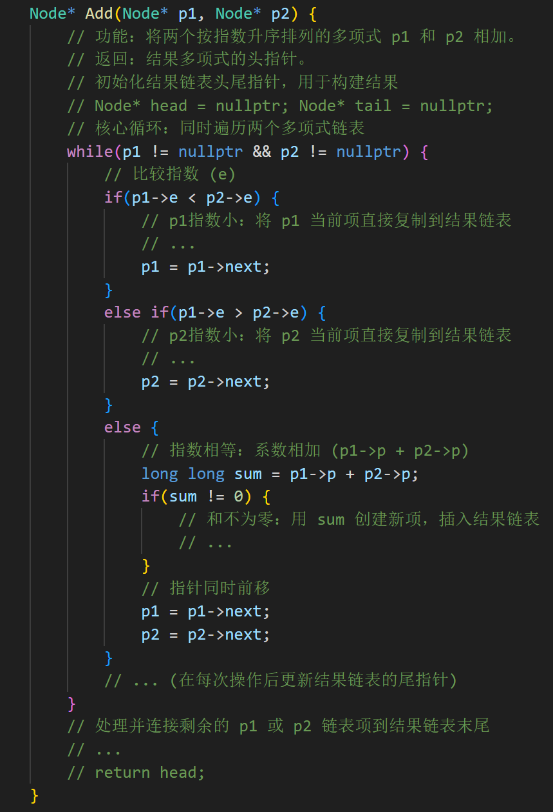

#### （2）多项式乘法
```cpp
@brief 计算两个多项式链表的乘积，采用Map进行同类项合并
@param p1 第一个多项式链表的头指针
@param p2 第二个多项式链表的头指针
@return Node* 指向结果多项式链表的头指针
```
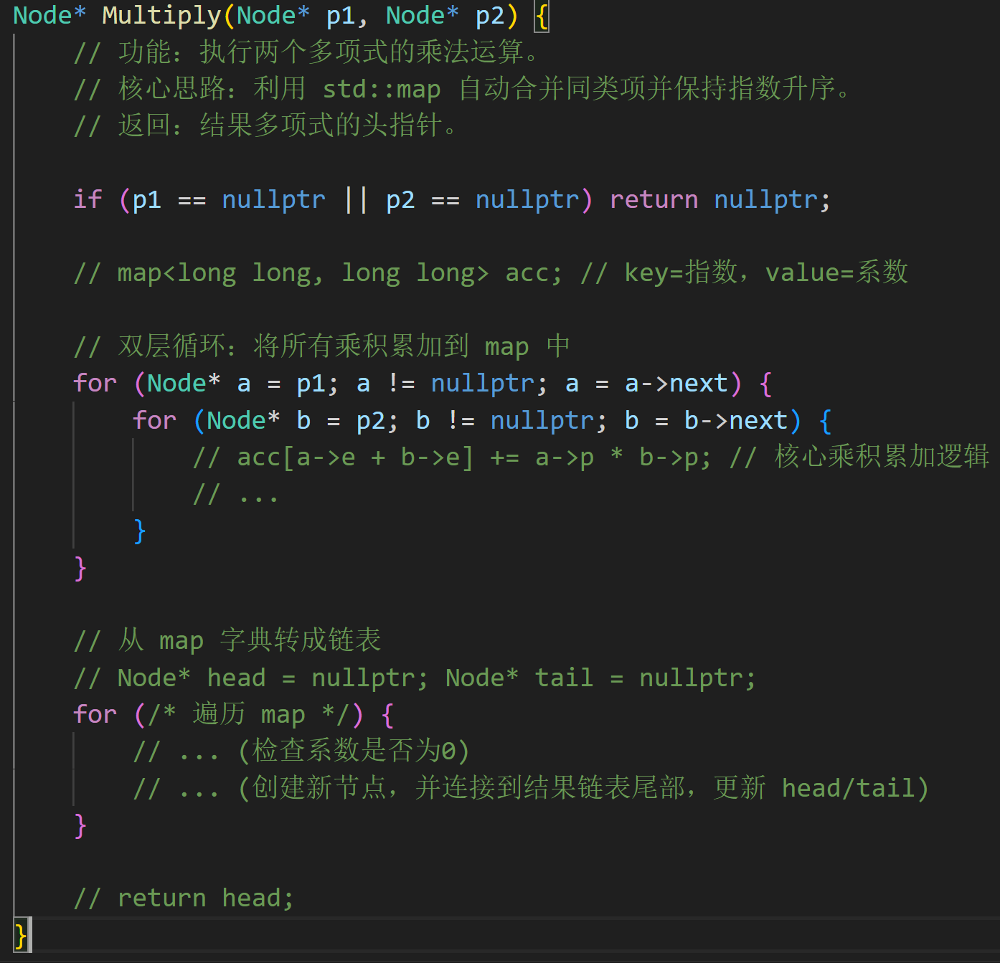
#### （3）打印输出函数
```cpp
@brief 打印输出多项式链表的内容
@param head 指向多项式链表的头指针
@return void 函数通过标准输出打印结果
```
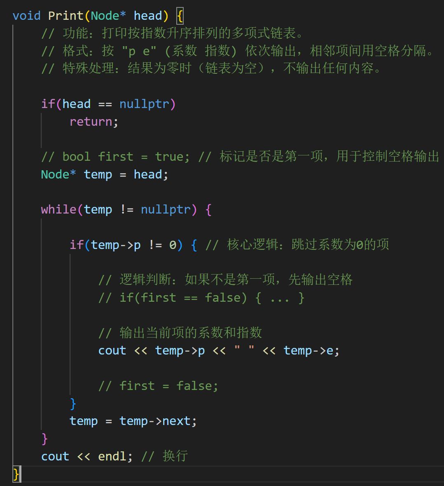

#### （4）读取输入函数
```cpp
@brief 读取多项式的输入，并构建链表
@param count 要读取的项数
@return Node* 指向构建好的多项式链表的头指针
```
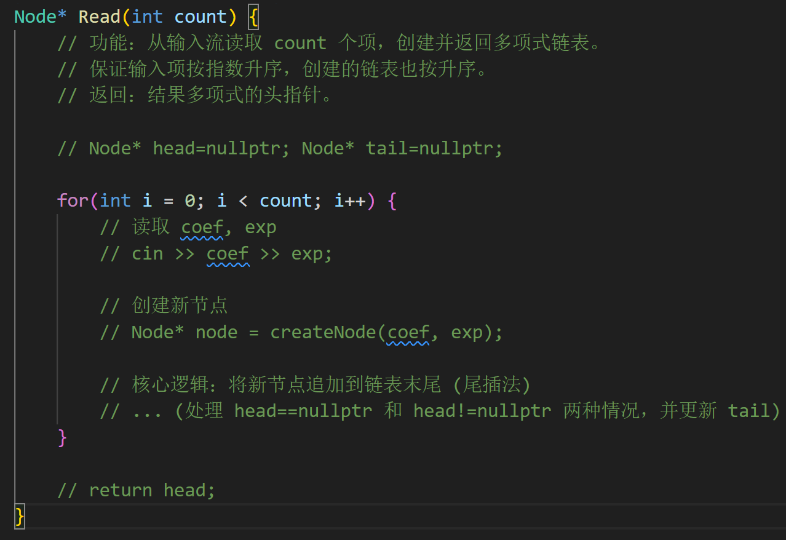

#### （5）释放内存函数
```cpp
@brief 释放多项式链表占用的所有内存
@param head 指向多项式链表的头指针
@return void 
```
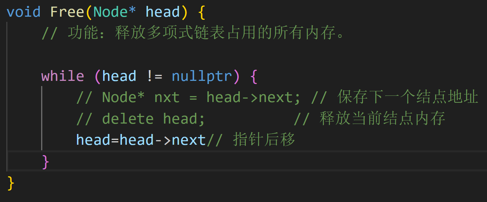
---

---
### 2.3.5 调试分析

1. **边界情况**

   * 输入为空表时，返回空指针；
   * 相加时系数可能抵消为 0，要正确删除；

2. **实现细节**

   * 实现多项式乘法部分，起初我采用手动寻找插入正确位置的方法。假设多项式有 n 项和 m 项，要做n * m 次乘法。每次乘法结果都要用函数 insertTerm 插进结果链表。insertTerm 时间复杂度为O(L)，L 是当前链表长度。最坏情况下链表长度接近 n*m。总体时间复杂度为 O((n\*m)^2) ，导致部分数据点TLE；
   * 优化为 map<long long,long long> 后，同样是O(n\*m) 次乘法，每次哈希表O(log K)累加。最后把 map 里的 (coef, exp) 转成链表即可。复杂度：O(n*m + K log K)，解决了TLE问题。
   * 每次运算结束后调用 Free 释放链表，避免内存泄漏。

---

### 2.3.6 总结与体会
* 通过本题我加深了对时间复杂度与空间复杂度权衡的理解：我采用了 std::map（基于红黑树的平衡树）作为中间容器，实现了“以空间换时间”的优化--利用 map 的自动排序与合并。
* 空间代价为引入了一个额外的 map<long long, long long> 存储空间（键为指数 exp，值为系数 coef）。但时间收益是这一阶段的总时间复杂度优化为 O(N⋅M⋅logK)。在没有出现MLE(memory limit exceed)的情况下解决了TLE问题。
---

## 实验四：求级数

### 2.4.1 问题描述

给定两个整数 N 和 A，计算级数的值：
$$ 
S = A + 2A^2 + 3A^3 + \cdots + N A^N 
$$
由于结果可能非常大（超过 long long 范围），需要用高精度算法实现。

---

### 2.4.2 基本要求

**输入：**
* 若干行，在每一行中给出整数N和A的值，（1<=N<=150，0<=A<=15）

* 对于20%的数据，有 1<=N<=12，0<=A<=5

* 对于40%的数据，有1<=N<=18，0<=A<=9

* 对于100%的数据，有1<=N<=150，0<=A<=15

* 对于每组输入，输出一个整数，表示级数的计算结果。


### 2.4.3 数据结构设计

本题采用 `vector<int>` 存储大数：

* 每个元素存储一位数字（0-9）。
* 低位存在 vector 前端，便于进位和乘法。

```cpp
vector<int> num;  // 存储大数，每个元素一位，低位在前
```
---

### 2.4.4 功能说明

#### 1. 整数转向量
```cpp
@brief 将一个 int 整数转换为一个 vector<int>，存储其每一位数字，低位在前
@param n 待转换的整数
@return vector<int> 存储 n 的每一位数字的向量
```
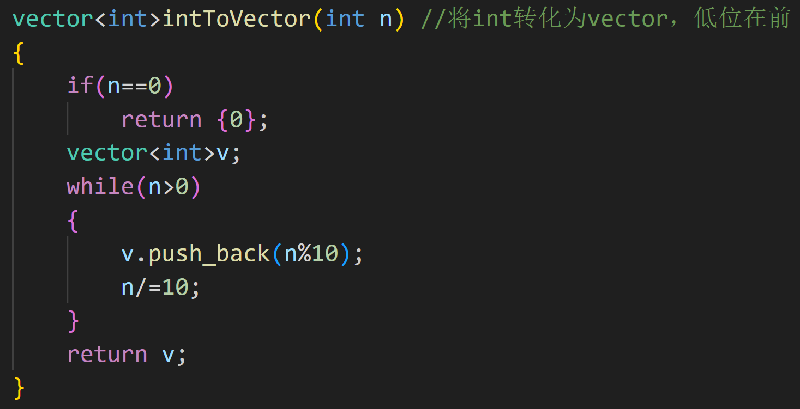

#### 2. 高精度加法
```cpp
@brief 实现了两个大数的加法运算，
大数以 vector<int> 形式存储，低位在前
@param a 第一个大数
@param b 第二个大数
@return vector<int> 表示 a + b 结果的大数
```
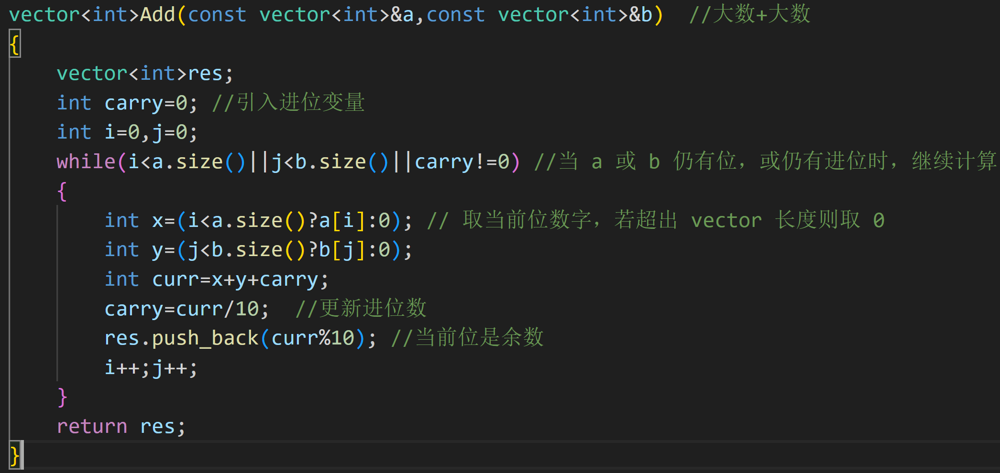

#### 3. 高精度乘法（大数 × 小整数）
```cpp
@brief 实现了大数与小数的乘法运算，
大数以 vector<int> 形式存储，低位在前
@param a 待乘的大数
@param b 待乘的小数
@return vector<int> 表示 a * b 结果的大数
```
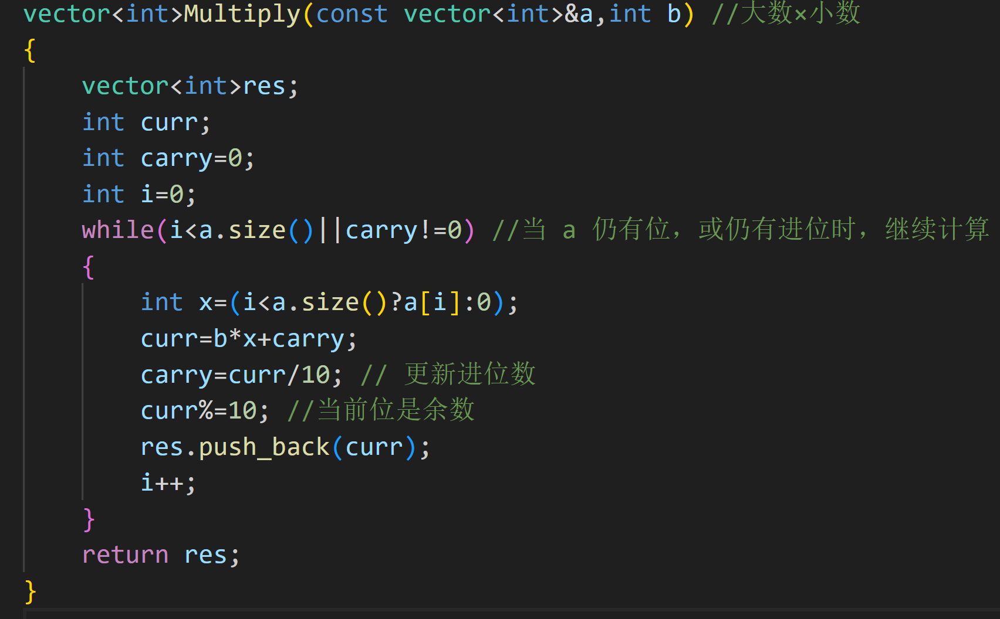

#### 4. 打印函数
```cpp
@brief 打印输出以 vector<int> 形式存储的大数，按从高位到低位的顺序输出
@param a 待打印的大数
@return void 函数通过标准输出打印结果
```
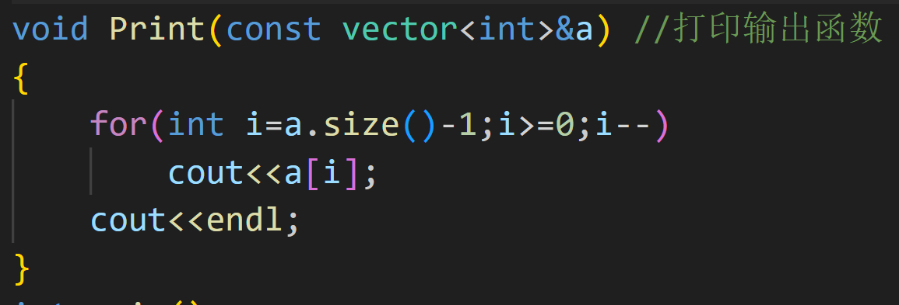

#### 5. 主流程
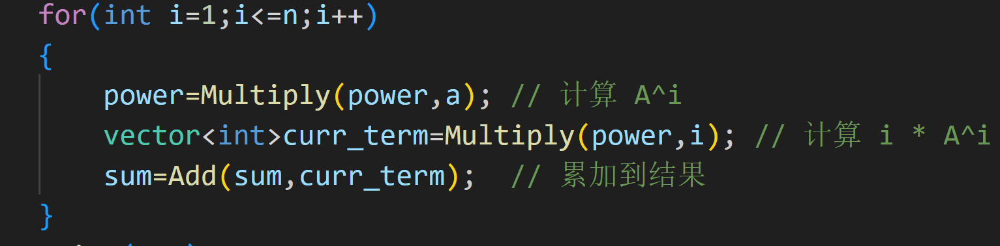

---

### 2.4.5 调试分析

1. **进位处理**：

   * 刚开始我忘记处理最后一次 carry，导致结果缺失高位。
   * 解决：循环条件加上 || carry != 0。
2. **高精度表示相关问题**
   * 使用 `vector<int>` 存储大整数，每个元素存一位，低位在前，方便进位运算。
   * 所有加法和乘法函数都要返回新的 `vector<int>`，避免直接修改原数导致逻辑错误。

---

### 2.4.6 总结与体会

通过本题，我学会了使用 `vector<int>` 存储大数。高精度运算的本质就是模拟手算：逐位相加、逐位相乘。
 
---

## 实验五：扑克牌游戏

### 2.5.1 题目描述

扑克牌有4种花色：黑桃（Spade）、红心（Heart）、梅花（Club）、方块（Diamond）。每种花色有13张牌，编号从小到大为：A,2,3,4,5,6,7,8,9,10,J,Q,K。

对于一个扑克牌堆，定义以下4种操作命令：

1. **添加（Append）**：添加一张扑克牌到牌堆的底部。如命令“Append Club Q”表示添加一张梅花Q到牌堆的底部。
2. **抽取（Extract）**：从牌堆中抽取某种花色的所有牌，按照编号从小到大进行排序，并放到牌堆的顶部。如命令“Extract Heart”表示抽取所有红心牌，排序后放到牌堆的顶部。
3. **反转（Revert）**：使整个牌堆逆序。
4. **弹出（Pop）**：如果牌堆非空，则除去牌堆顶部的第一张牌，并打印该牌的花色和编号；如果牌堆为空，则打印NULL。

初始牌堆为空。输入 n 个操作命令（1 ≤ n ≤ 200），执行对应指令，最后打印牌堆中所有牌（从顶到底）。

---

### 2.5.2 基本要求

**输入**：

* 第一行输入一个整数 n，表示命令数量。
* 接下来的 n 行，每行输入一个命令。

**输出**：

* 每次收到 Pop 指令后输出一行（花色和编号或 NULL）。
* 所有操作完成后，打印牌堆中牌（从顶到底），若牌堆为空则输出 NULL。

---
### 2.5.3 数据结构设计

本实验使用链表（单链表）存储牌堆，每个节点为一张牌，定义如下：
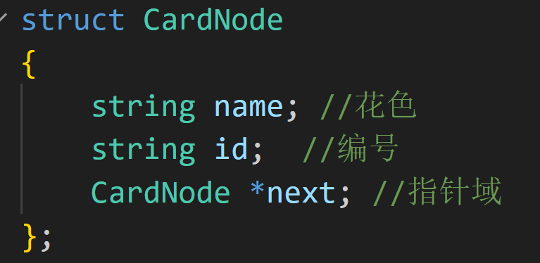

---

### 2.5.4 功能说明

#### 1. 创建节点
```cpp
@brief 创建一个新的 CardNode 结点
@param name 牌的花色
@param id 牌的编号
@return CardNode* 指向新创建结点的指针
```
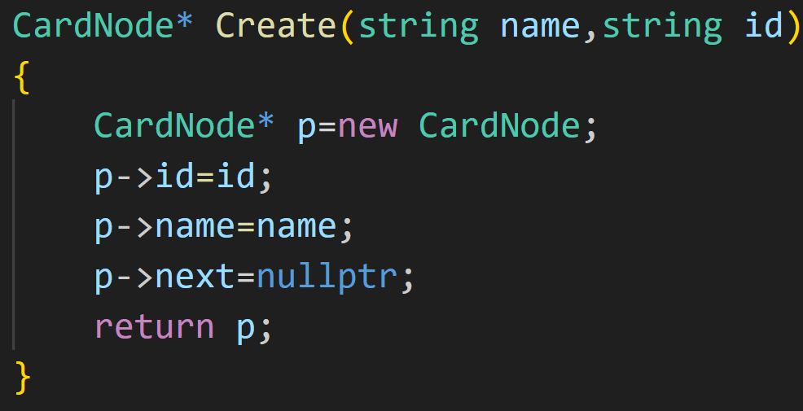

#### 2. 添加（Append）
```cpp
@brief 将一张牌添加到牌堆的底部（链表尾部）
@param name 待添加牌的花色
@param id 待添加牌的编号
@param head 指向牌堆链表的头指针
@return CardNode* 更新后的牌堆链表的头指针
```
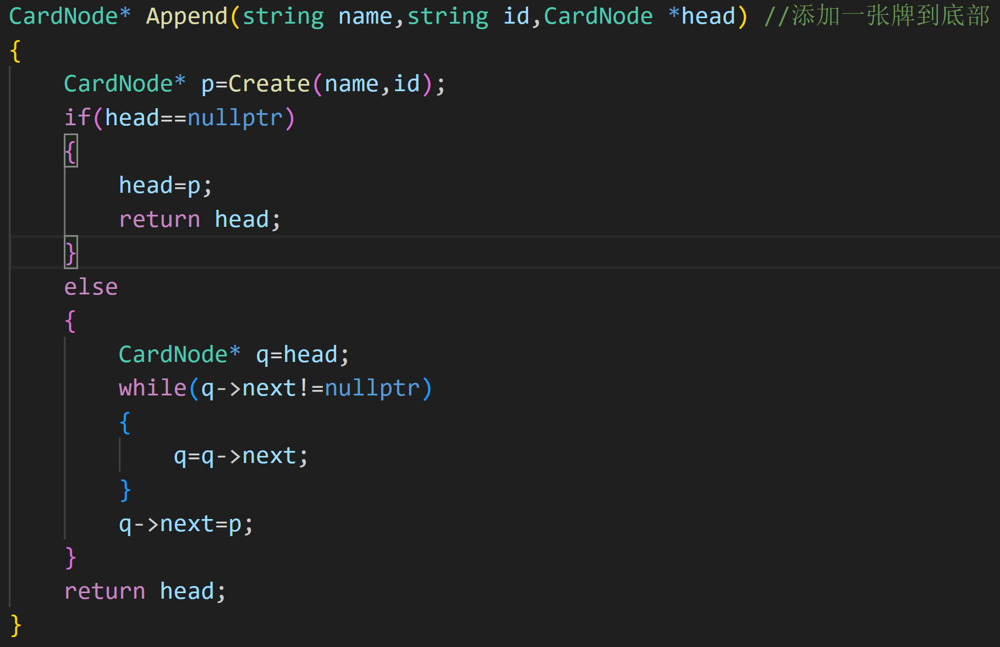

#### 3. 花色抽取（Extract）
首先定义辅助排序函数，用于比较扑克牌特殊编码大小
```cpp
@brief

 获取扑克牌编号在预设顺序中的排名
@param id 扑克牌的编号（A, 2, ..., K）
@return int 牌在顺序中的索引（A=0, K=12），如果找不到返回 -1
```
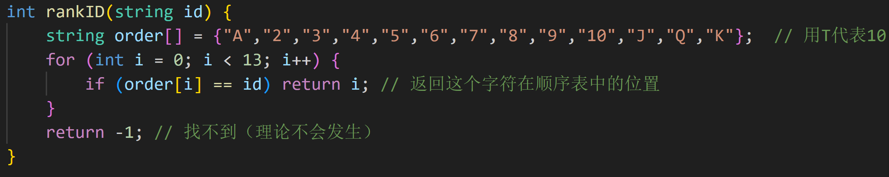
其次定义主实现函数
```cpp
@brief 抽取指定花色的所有牌，并按编号升序（A到K）放到牌堆的顶部
@param name 待抽取的花色
@param head 指向牌堆链表的头指针
@return CardNode* 更新后的牌堆链表的头指针
```
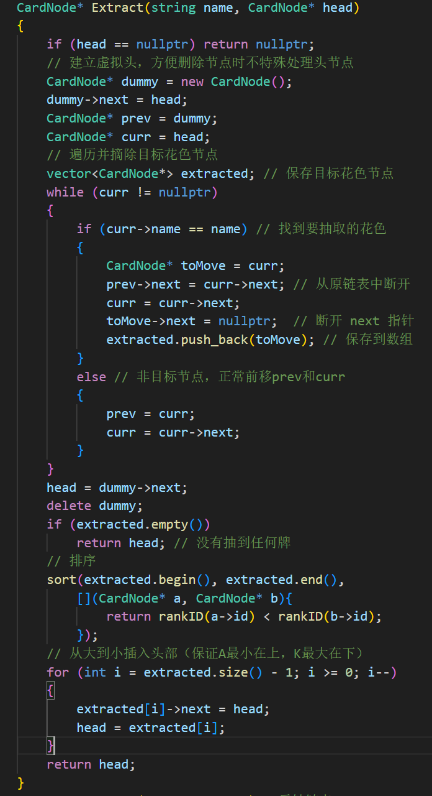

#### 4. 反转（Revert）
```cpp
@brief 反转牌堆的顺序（链表反转）
@param head 指向牌堆链表的头指针
@return CardNode* 反转后新牌堆的头指针
```
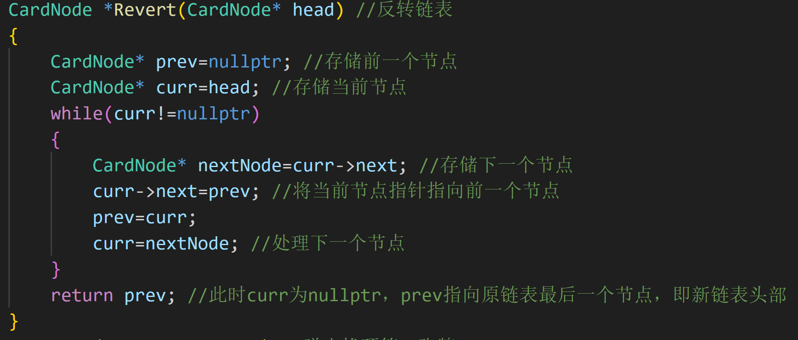

#### 5. 弹出（Pop）
```cpp
@brief 弹出并输出牌堆最上面一张牌（链表头节点），并释放内存，如果牌堆为空，输出 "NULL"
@param head 牌堆链表的头指针的引用
@return void 函数通过标准输出打印结果
```
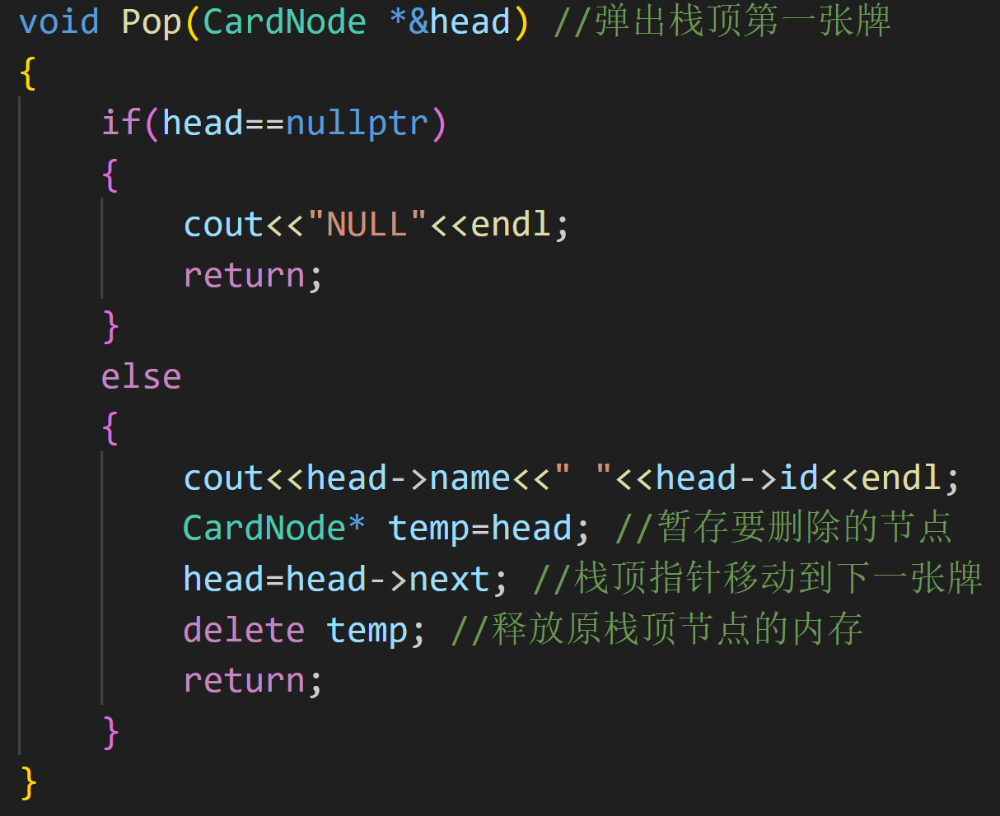

#### 6. 打印牌堆
```cpp
@brief 打印牌堆中所有牌的花色和编号，每张牌占一行，如果牌堆为空，输出 "NULL"
@param head 指向牌堆链表的头指针
@return void 函数通过标准输出打印所有牌
```
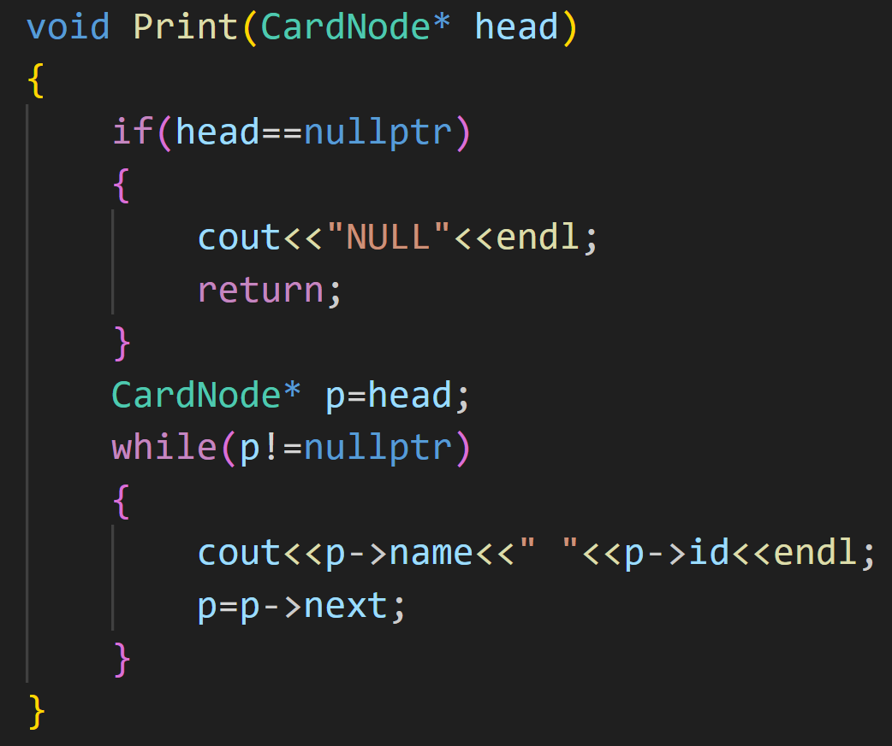

---

### 2.5.5 调试分析

1. **Extract 节点插入TLE**
   * 起初我设计Extract函数的思路是：边遍历边移动节点（在原链表上操作），每次插入时从头遍历找到合适位置插入。这就意味着在最坏情况下：链表有 n 张牌，所有牌都属于要抽取的花色，每抽一张，就需要从头扫一遍前面已插入的节点。因此，时间复杂度的最坏情况是 O(n²)。导致后面的数据点直接TLE。
   * 解决：
   1. 第一步：一次性取出所有目标花色节点。
   2. 第二步：利用sort函数对摘出的节点排序（O(k log k)）。
   3. 第三步：把排好序的牌插回原链表头部（O(k)）。
   这样，整个 Extract 的复杂度是：
   O(n)（抽取） + O(k log k)（排序） ≈ O(n log n)
    由此解决TLE问题。

2. **Revert 边界条件**

   * 链表为空或仅有一张牌时，prev 和 curr 指针处理需小心。
   * 解决：循环终止条件为 curr != nullptr，并返回 prev 作为新头。

---

### 2.5.6 总结与体会

通过本实验，我加深了对链表的基本操作的理解及其在扑克牌堆管理中的应用。
* extract函数实现中，在头指针前再加入虚拟指针（数据域不存储任何实际意义的数值），有时候能便于操作
* 链表在建立时对边界条件（即head指针是否为空等）需要额外注意处理
---

## 实验总结
通过本次实验，我加深了对两大线性表数据结构--链表和顺序表的理解与掌握，尤其是对链表与cpp中指针操作更加熟悉。学会应用线性表处理一些实际问题，认识到线性表这类简单的数据结构在实际生活中有着很广泛的应用与很强大的功能。