## 邻接矩阵法：数组实现的顺序存储
```cpp
#define MAX_VERTEX_NUM 100 //最大顶点个数
#define INFINITY INT_MAX //带权图中无边的顶点之间权值用无穷表示
typedef char VertexType; //顶点的数据类型
typedef int EdgeType; //带权图中边上权值的数据类型

//邻接矩阵法：
struct VNode
{
    VertexType data; //存储顶点信息
    //其他信息
};

struct UDMGraph //无权图
{
    VNode Vex[MAX_VERTEX_NUM]; //顶点表
    bool Edge[MAX_VERTEX_NUM][MAX_VERTEX_NUM]; //边表：邻接矩阵
    int vexnum,arcnum; //图当前的顶点数与边数
};

struct WDMGraph //带权图（网）
{
    VNode Vex[MAX_VERTEX_NUM]; //顶点表
    EdgeType Edge[MAX_VERTEX_NUM][MAX_VERTEX_NUM]; //边表：邻接矩阵
    int vexnum,arcnum; //网当前的顶点数与边数
};

int LocateVex(UDMGraph G,VertexType u) //根据节点数据定位下标
{
    int i;
    for(i=0;i<G.vexnum;i++)
    {
        if(u==G.Vex[i].data)
            return i;
    }
    if(i==G.vexnum)
    {
        cout<<"Error u!\n";
        exit(1);
    }
    return 0;
}

int LocateVex(WDMGraph G,VertexType u) //根据节点数据定位下标
{
    int i;
    for(i=0;i<G.vexnum;i++)
    {
        if(u==G.Vex[i].data)
            return i;
    }
    if(i==G.vexnum)
    {
        cout<<"Error u!\n";
        exit(1);
    }
    return 0;
}

void CreateUDMGraph(UDMGraph &G) //初始化无权图
{
    cout<<"请输入顶点数与边数：\n";
    cin>>G.vexnum>>G.arcnum;
    cout<<"请输入顶点具体信息：\n";
    for(int i=0;i<G.vexnum;i++)
        cin>>G.Vex[i].data;
    for(int i=0;i<G.vexnum;i++)
        for(int j=0;j<G.vexnum;j++)
            G.Edge[i][j]=0; //初始化
    VertexType v1,v2;
    int i,j; //输入的顶点的下标
    for(int k=0;k<G.arcnum;k++)
    {
        cout<<"请输入顶点1 顶点2，在之间建立边\n";
        cin>>v1>>v2;
        i=LocateVex(G,v1);
        j=LocateVex(G,v2);
        G.Edge[i][j] = 1;  
        G.Edge[j][i] = 1;  
    }
    return;
}

void CreateWDMGraph(WDMGraph &G) //初始化带权图
{
    cout<<"请输入顶点数与边数：\n";
    cin>>G.vexnum>>G.arcnum;
    cout<<"请输入顶点具体信息：\n";
    for(int i=0;i<G.vexnum;i++)
        cin>>G.Vex[i].data;
    for(int i=0;i<G.vexnum;i++)
        for(int j=0;j<G.vexnum;j++)
            G.Edge[i][j]=INFINITY; //初始化
    VertexType v1,v2;
    EdgeType w;
    int i,j; //输入的顶点的下标
    for(int k=0;k<G.arcnum;k++)
    {
        cout<<"请输入顶点1 顶点2之间的边：\n";
        cin>>v1>>v2>>w;
        i=LocateVex(G,v1);
        j=LocateVex(G,v2);
        G.Edge[i][j]=w;
        G.Edge[j][i]=w; //注意有向图和无向图此句不一样
    }
    return;
}
```
由邻接矩阵求图中的路径数目：
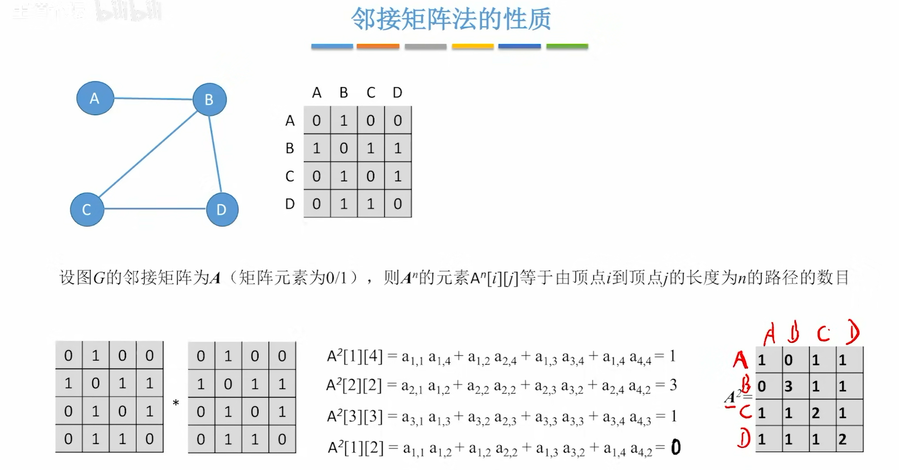
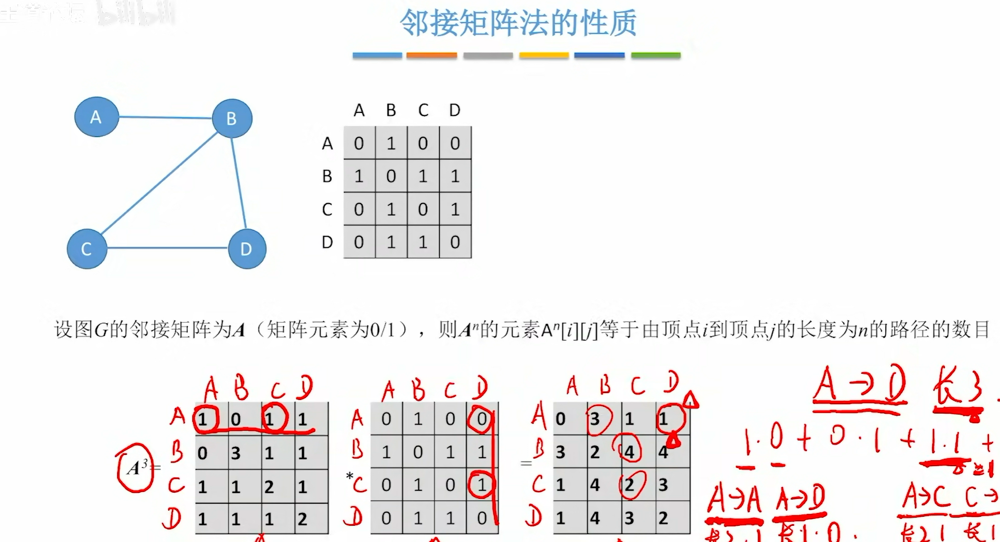

---
## 邻接表法：顺序+链式存储
头结点数组的索引 i,起点 Vi​（即出边 Vi​→Vj​ 的 Vi​）
ArcNode 结构体中的 adjvex,终点 Vj​（即出边 Vi​→Vj​ 的 Vj​）

#### 无向图的邻接表：
```cpp
//邻接表法：
struct ArcNode //边节点
{
    int adjvex; //与边关联的另一顶点的顶点下标
    ArcNode* next; //指向下一条弧的指针
    EdgeType info; //边权值
};

struct VNode
{
    VertexType data; //存储顶点信息
    ArcNode *first; //指向第一条边的指针
};

struct ALGraph //图
{
    VNode AdjList[MAX_VERTEX_NUM]; //邻接表
    int vexnum,arcnum; //图当前的顶点数与边数
};

int LocateVex(ALGraph G,VertexType u) //根据节点数据定位下标
{
    int i;
    for(i=0;i<G.vexnum;i++)
    {
        if(u==G.AdjList[i].data)
            return i;
    }
    if(i==G.vexnum)
    {
        cout<<"Error u!\n";
        exit(1);
    }
    return 0;
}

void CreateALGraph(ALGraph &G) //邻接表的初始化
{
    ArcNode* p;
    cout<<"请输入顶点数与边数：\n";
    cin>>G.vexnum>>G.arcnum;
    cout<<"请输入各顶点具体信息：\n";
    for(int i=0;i<G.vexnum;i++)
    {
        cin>>G.AdjList[i].data;
        G.AdjList[i].first=NULL; //初始化置空
    }
    VertexType v1,v2;
    EdgeType w;
    int i,j; //输入的顶点的下标
    cout<<"请输入顶点1 顶点2，在之间建立边\n";
    for(int k=0;k<G.arcnum;k++)
    {
        cin>>v1>>v2>>w;
        i=LocateVex(G,v1);
        j=LocateVex(G,v2);
        p=(ArcNode*)malloc(sizeof(ArcNode));
        p->adjvex=j;
        p->info=w; //以上存储好了信息，现在开始建立链表
        p->next=G.AdjList[i].first;
        G.AdjList[i].first=p;
        //若为无向图，则需要再次建立j与i之前的关联
        p=(ArcNode*)malloc(sizeof(ArcNode));
        p->adjvex=i;
        p->info=w; //以上存储好了信息，现在开始建立链表
        p->next=G.AdjList[j].first;
        G.AdjList[j].first=p;
    }
}

```
#### 有向图的邻接矩阵：
相较无向图，每个定点之后的链表中定点只包含从该点向外指向的顶点；至于链表中每个定点的顺序我们并不关心，取决于你输入的顺序。

顶点vi的出度是它的链表中的节点个数，入度是所有链表中vi出现的个数。

在带权图中，边节点中要带上权的数据域。

## 两种方法对比：
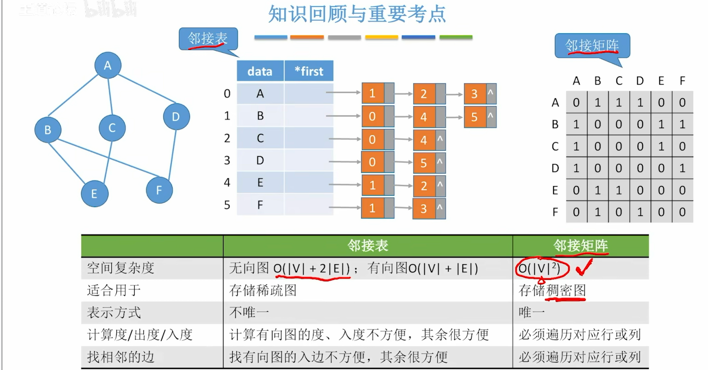
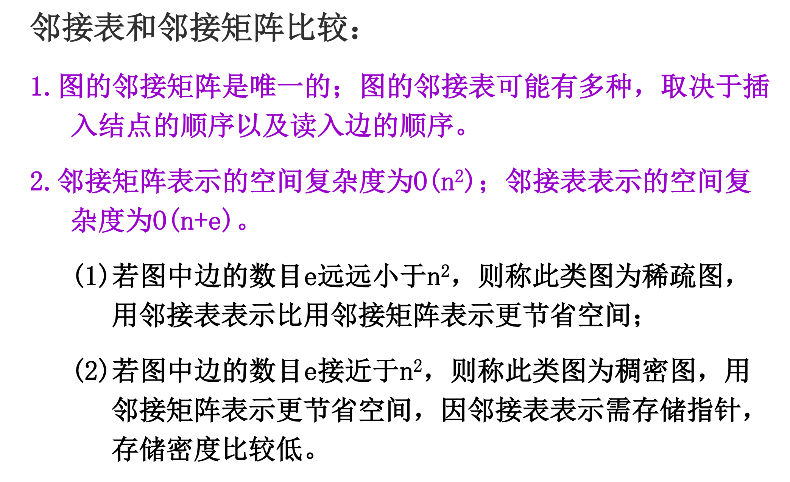
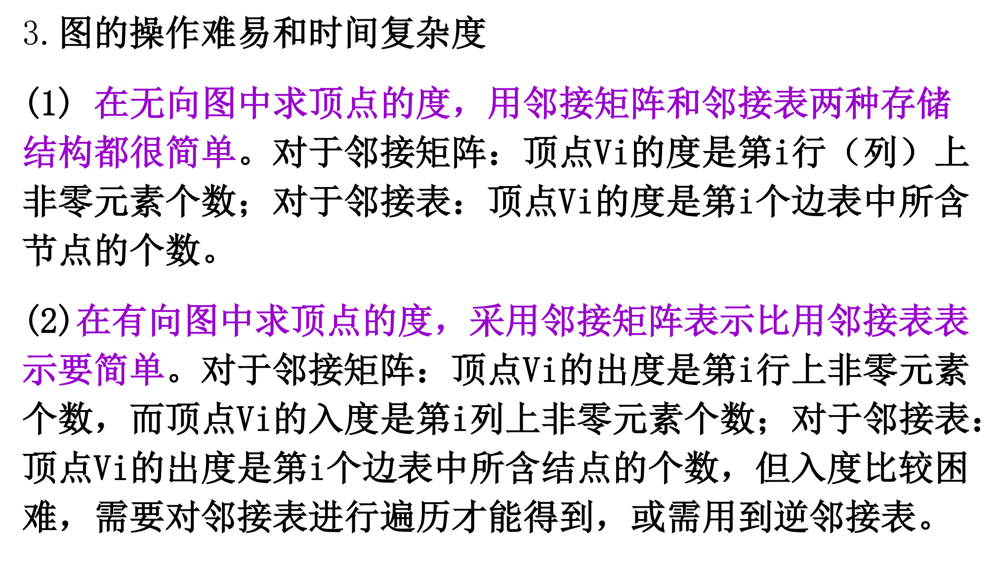
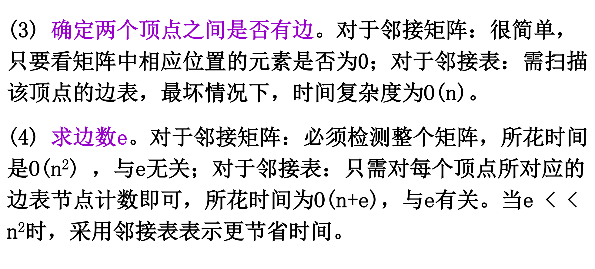

---

### 图的遍历
#### 深度优先搜索
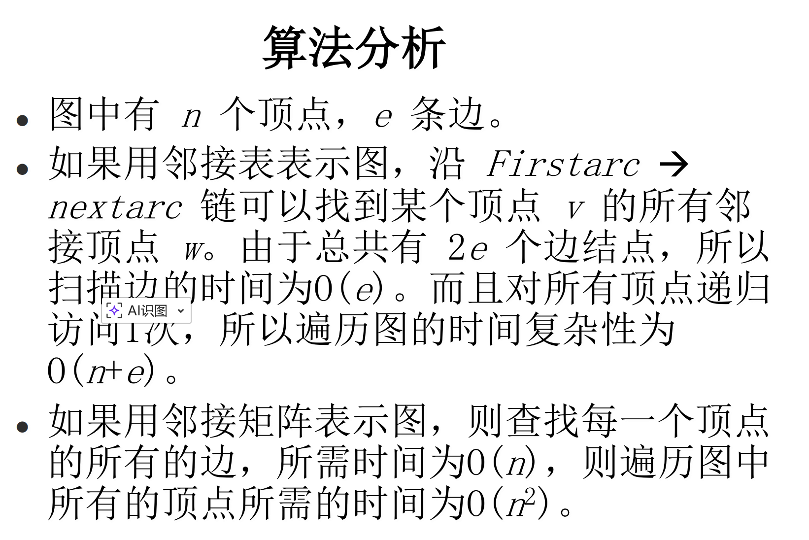
```cpp
//图的DFS算法
bool visited[MAX_VERTEX_NUM]={0}; //标记是否被访问过
void DFS(ALGraph G,int v) //从第v个顶点出发DFS，若是连通图则整个图都被遍历
{
    ArcNode* p;
    cout<<"从点"<<G.AdjList[v].data<<"开始遍历（DFS）\n";
    visited[v]=1;
    p=G.AdjList[v].first;
    while(p)
    {
        if(visited[p->adjvex]==0)
            DFS(G,p->adjvex);
        p=p->next;
    }
}

void DFSTraverse(ALGraph G) //整个图的DFS遍历（如果不是连通图）
{
    for(int v=0;v<G.vexnum;v++)
        if(visited[v]==0)
            DFS(G,v);
}

```
--- 

#### 广度优先搜索
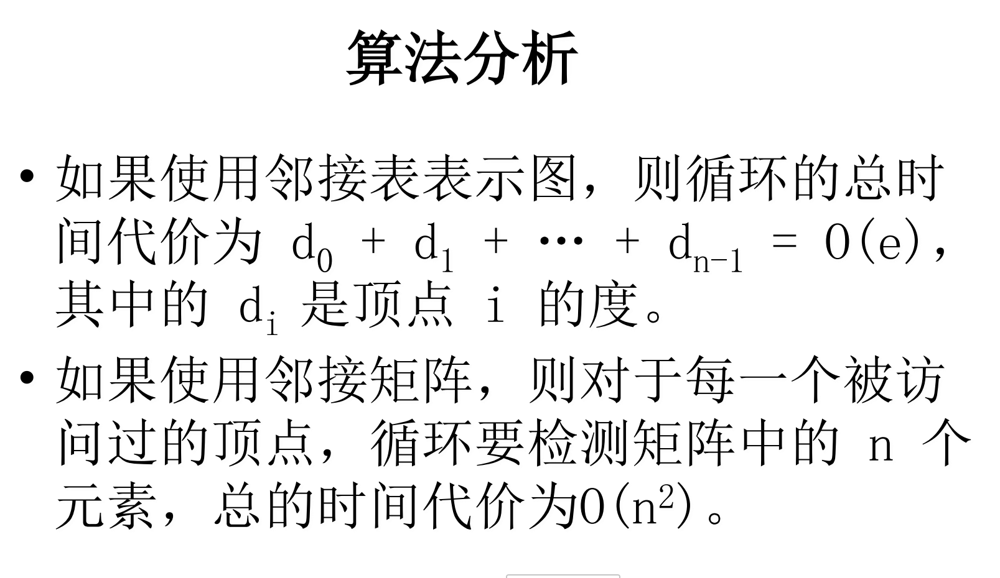
```cpp
void BFS(ALGraph G,int v)
{
    ArcNode* p;
    cout<<"从点"<<G.AdjList[v].data<<"开始遍历（BFS）\n";
    visited[v]=1;
    SqQueue Q;
    InitQueue(Q);
    Q.base[Q.rear]=v;
    Q.rear=(Q,rear+1)%MAXQSIZE;
    while(Q.front!=Q.rear)
    {
        v=Q.base[Q.front];
        Q.front=(Q.front+1)%MAXQSIZE;
        cout<<G.AdjList[v].data<<" ";
        p=G.AdjList[v].first;
        while(p)
        {
            if(visited[p->adjvex]==0)
            {
                
                visited[p->adjvex]=1;
                Q.base[Q.rear]=p->adjvex;
                Q.rear=(Q.rear+1)%MAXQSIZE;
            }
            p=p->next;
        }
    }
}

void BFSTraverse(ALGraph G) //整个图的BFS遍历（如果不是连通图）
{
    for(int v=0;v<G.vexnum;v++)
        if(visited[v]==0)
            BFS(G,v);
}
```

---

### Prim算法
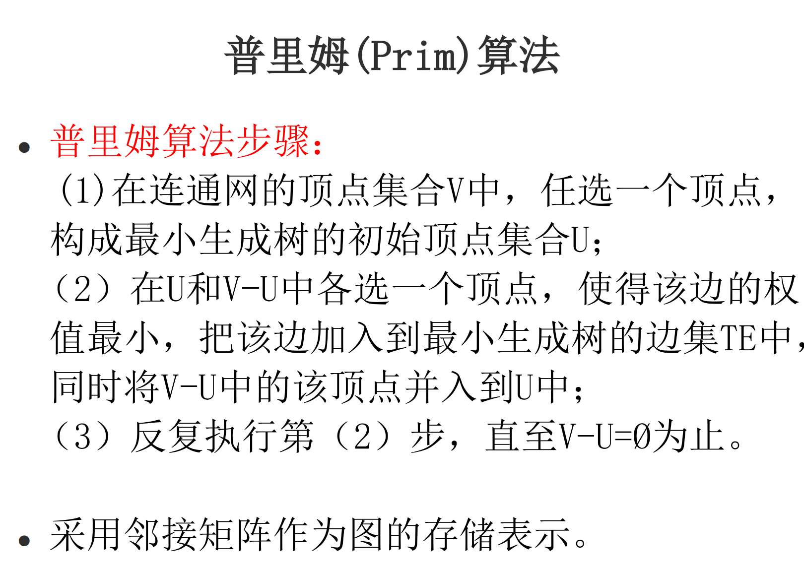
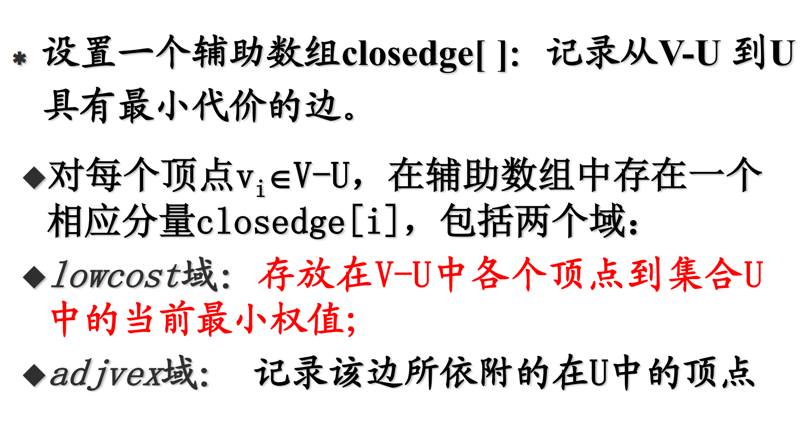
```cpp
struct closedge
{
    EdgeType lowcost; //最小权值：对于未加入 MST 的顶点 j，closedge[j].lowcost 存储的是它到当前 MST 集合中所有顶点的边中，权值最小的那条边的权值。
    //一旦顶点 j 被加入 MST，它的 lowcost 会被设置为 0（这是算法中标记“已加入”的方式）。
    VertexType adjvex; //对于未加入 MST 的顶点 j，closedge[j].adjvex 存储的是与它形成 lowcost 那条边的已加入 MST 集合中的顶点。
};
void Prim(WDMGraph G,VertexType u)
{
    int k,j,i,minCost;
    closedge arr_closedge[MAX_VERTEX_NUM];
    k=LocateVex(G,u); //确定起始顶点u的下标k
    //初始化closedge数组，将其余顶点都暂时与k关联
    for(int j=0;j<G.vexnum;j++)
    {
        if(j!=k)
        {
            arr_closedge[j].adjvex=u;
            arr_closedge[j].lowcost=G.Edge[k][j];
        }
    }
    arr_closedge[k].lowcost=0; //将k加入MST
    //最外层循环：一共有n-1条边循环n-1次
    for(int i=1;i<G.vexnum;i++) 
    {
        minCost=INFINITY;
        for(j=0;j<G.vexnum;j++) // 遍历所有顶点 j，寻找最小 lowcost
        {
            // 查找尚未加入 MST 集合 (lowcost != 0) 且 lowcost 最小的顶点 k
            if(arr_closedge[j].lowcost!=0&&arr_closedge[j].lowcost<minCost)
            {
                minCost=arr_closedge[j].lowcost;
                k=j; // 记录该顶点的下标 k
            }
        }
        if(minCost == INFINITY)
        {
            cout << "Graph is not connected!" << endl;
            return;
        }
        cout << "(" << arr_closedge[k].adjvex << "," << G.Vex[k].data << ")" << endl;
        arr_closedge[k].lowcost=0;
        //更新arr_closedge数组
        for(int j=0;j<G.vexnum;j++)
        {
            if(G.Edge[k][j]<arr_closedge[j].lowcost&&arr_closedge[j].lowcost != 0 ) // 如果通过新顶点 k 连接更短，小心边权值为0的情况
            {
                arr_closedge[j].adjvex=G.Vex[k].data; // j 现在应该连接到 k
                arr_closedge[j].lowcost=G.Edge[k][j]; // 更新为更小的权值
            }
        }
        
    }
}
```

### Kruskal算法
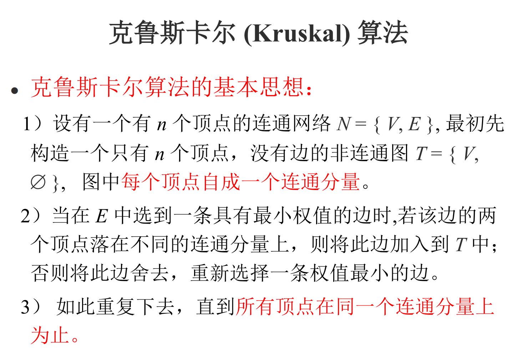

### 拓扑排序
在邻接表的头结点中增设一个域indegree  记录各顶点入度，入度为0的顶点即为无前驱的顶点，是要入栈的
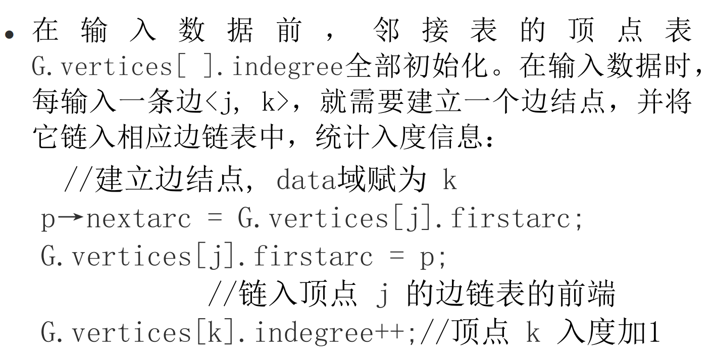
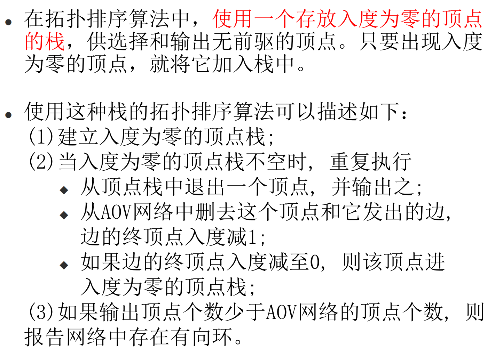
用数组模拟栈：
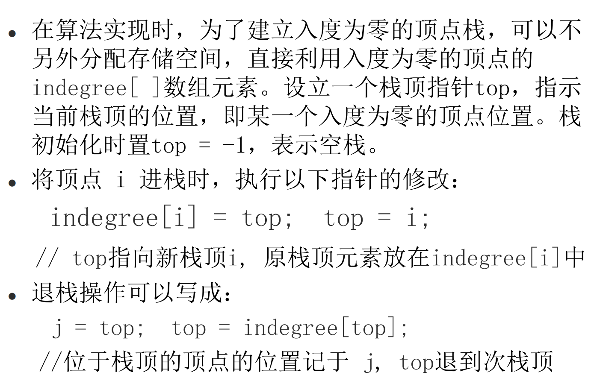
相当于把每个顶点的 indegree 变成一个链表的 next 指针，连接所有入度为 0 的顶点。
这个链表的表头由 top 指向。

# 🔥 示例图（最简单）

假设有下面的图：

```
v0 → v2
v1 → v2
v2 → v3
```

入度如下：

| 顶点 | 入度 |
| -- | -- |
| 0  | 0  |
| 1  | 0  |
| 2  | 2  |
| 3  | 1  |

---

# ⭐ 第一步：初始化栈（所有入度为 0 的点入栈）

代码：

```cpp
int top = -1;
for(i = 0; i < vexnum; i++)
    if(indegree[i] == 0) {
        indegree[i] = top;
        top = i;
    }
```

### 依次检查顶点 0、1、2、3：

---

### ✔ 检查 v0，入度 0 → 入栈

```
indegree[0] = top = -1
top = 0
```

现在栈链表是：

```
top → 0 → -1
```

---

### ✔ 检查 v1，入度 0 → 入栈

```
indegree[1] = top = 0
top = 1
```

栈：

```
top → 1 → 0 → -1
```

---

### ✔ 检查 v2，入度 2，不入栈

### ✔ 检查 v3，入度 1，不入栈

---

# 🎉 初始化完毕，栈如下：

```
top → 1 → 0 → -1
```

> 栈顶是 1，下面是 0。这完全是一条链，保存在 indegree[] 里。

---

# ⭐ 第二步：开始拓扑排序（不断 pop → 输出 → 更新邻居入度 → 新入度为 0 的入栈）

代码：

```cpp
while(top != -1) {
    i = top;
    top = indegree[top];
}
```

---

# 🟩 **第一次出栈（pop）**

```
i = top = 1
top = indegree[1] = 0
```

输出：

```
1
```

更新邻居：

* 1 → 2，所以 indegree[2]--
  入度从 2 → 1，不入栈

此时：

```
栈 top → 0 → -1
```

---

# 🟩 **第二次出栈（pop）**

```
i = top = 0
top = indegree[0] = -1
```

输出：

```
1 0
```

更新邻居：

* 0 → 2，所以 indegree[2]--
  入度从 1 → 0，入度变为 0 → 入栈！

代码：

```cpp
indegree[2] = top (-1);
top = 2;
```

新栈链：

```
top → 2 → -1
```

---

# 🟩 **第三次出栈（pop）**

```
i = top = 2
top = indegree[2] = -1
```

输出：

```
1 0 2
```

更新邻居：

* 2 → 3，所以 indegree[3]--
  入度从 1 → 0，入栈：

```
indegree[3] = top (-1);
top = 3;
```

栈：

```
top → 3 → -1
```

---

# 🟩 **第四次出栈（pop）**

```
i = top = 3
top = indegree[3] = -1
```

输出：

```
1 0 2 3
```

图结束。

---

# ⭐ 全过程 indegree 数组变化（关键！）

初始化（真实入度）：

```
indegree: [0,0,2,1]
```

入栈以后 indegree[] 被复用为 next 指针：

| 顶点 | indegree 含义                       |
| -- | --------------------------------- |
| 0  | **0 的 next = -1**                 |
| 1  | **1 的 next = 0**                  |
| 2  | 入度（最初 2；后变成 1；后变成 0；再被赋成 next=-1） |
| 3  | 入度（最初 1；后变成 0；再赋成 next=-1）        |

也就是说：

### ✔ indegree > 0 → 表示真实入度

### ✔ indegree == 0 → 刚变成 0，马上会入栈

### ✔ 一旦入栈 → indegree 被覆盖成 next 指针

---

# ⭐ 总结（你需要记住的就 3 句话）

### ① “入度=0” 的点会入栈：

```cpp
indegree[i] = top;
top = i;
```

### ② 栈本质是一条链表，next 指针保存在 indegree[i] 里。

### ③ pop 的时候：

```cpp
i = top;
top = indegree[top];
```

---

拓扑排序算法：
```cpp
bool toplogicalSort(ALGraph G) //拓扑排序
{
    ArcNode *p;
    int top=-1; //入度为0的顶点栈初始化
    int i;
    for(i=0;i<G.vexnum;i++)
    {
        if(G.AdjList[i].indegree==0)
        {
            G.AdjList[i].indegree=top;
            top=i; //入度为0的顶点进栈
        }
    }
    int count=0;
    while(top+1)
    {
        i=top;
        top=G.AdjList[top].indegree; //入度为0的顶点出栈
        cout<<i<<" "<<G.AdjList[i].data;
        ++count;
        for(p=G.AdjList[i].first;p;p=p->next) //扫描该顶点的出边表
        {
            int k=p->adjvex; //边的另一顶点
            G.AdjList[k].indegree--; //该顶点入度减一
            if(G.AdjList[k].indegree==0)
            {
                G.AdjList[k].indegree=top;
                top=k; //入度为0的顶点入栈
            }
        }
    }
    if(count<G.vexnum)
        return false; //有向环
    else
    return true;
} 
```
## 最短路径问题
### Dijkstra算法：
不允许权值为负数
求从源点到终点的最短路径
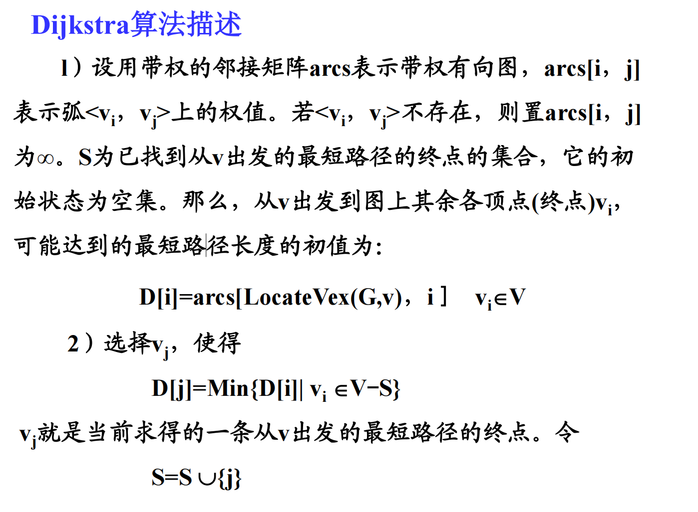
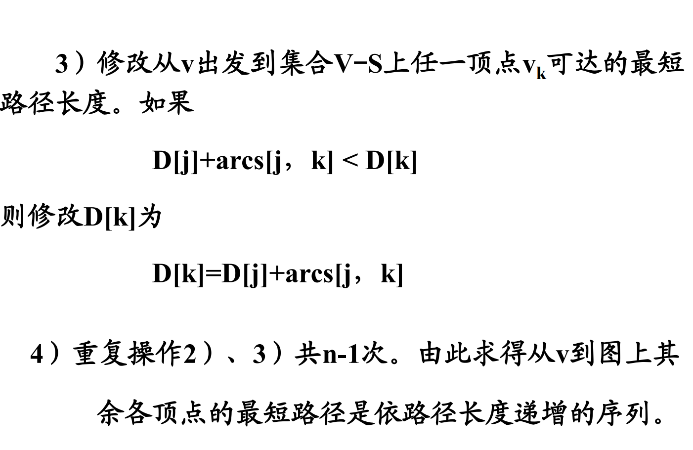
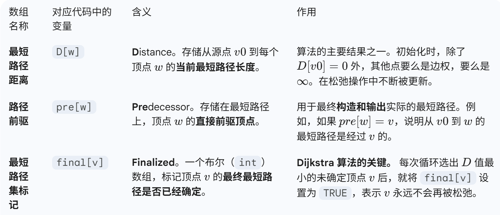
```cpp
//Dijkstra算法：使用邻接矩阵实现
int Distance_DIJ[MAX_VERTEX_NUM]; //存储从源点到每个顶点的当前最短路径长度
int pre[MAX_VERTEX_NUM]; //存储在最短路径上顶点i的前驱顶点
bool final[MAX_VERTEX_NUM]; //标记顶点v的最终最短路径是否已经确定

struct VNode
{
    VertexType data; //存储顶点信息
    //其他信息
};

struct WDMGraph //带权图（网）
{
    VertexType Vex[MAX_VERTEX_NUM]; //顶点表
    int AdjMatrix[MAX_VERTEX_NUM][MAX_VERTEX_NUM]; //边表：邻接矩阵
    int vexnum,arcnum; //网当前的顶点数与边数
};

void ShortestPath_DIJ(WDMGraph G,int u0,int Distance_DIJ[],int pre[])
{
    int min_dist; //存储当前找到的最小距离
    for(int v=1;v<=G.vexnum;v++)
    {
        final[v]=0;
        Distance_DIJ[v]=G.AdjMatrix[u0][v]; //距离初始化为u0到v的边权
        pre[v]=(Distance_DIJ[v]<INFINITY)?u0:-1; //若可达，前驱是u0
    }
    Distance_DIJ[u0]=0;
    final[u0]=1;
    pre[u0]=-1;
    //遍历G.vexnum-1次，每次确定一个顶点的最短路径
    for(int i=1;i<G.vexnum;i++)
    {
        //1.找到当前Distance_DIJ[]中最小的未确定顶点
        min_dist=INFINITY;
        int u; //顶点下标
        for(int j=0;j<G.vexnum;j++)
        {
            if(final[j]==0&&Distance_DIJ[j]<min_dist)
            {
                u=j;
                min_dist=Distance_DIJ[j];
            }
        }
        final[u]=1;
        //2.以u为中介点，更新所有邻接点w的距离：是否通过u到达w的路径更短？
        for(int w=0;w<G.vexnum;w++)
        {
            // 确保 w 未被确定最终最短路径
            // 并且 u 到 w 是有边的 (G.AdjMatrix[u][w] < INFINITY)
            if(final[w]==0&&G.AdjMatrix[u][w]<INFINITY)
            {
                if(min_dist+G.AdjMatrix[u][w]<Distance_DIJ[w])
                {
                    Distance_DIJ[w]=min_dist+G.AdjMatrix[u][w];
                    pre[w]=u;
                }
            }
        }
    }
}
```
### Floyd算法：
允许图中有负权值的边，但不允许有包含负权值的边组成的回路
求每一对顶点之间的最短路径
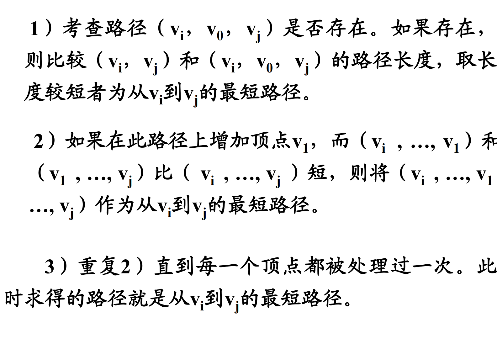
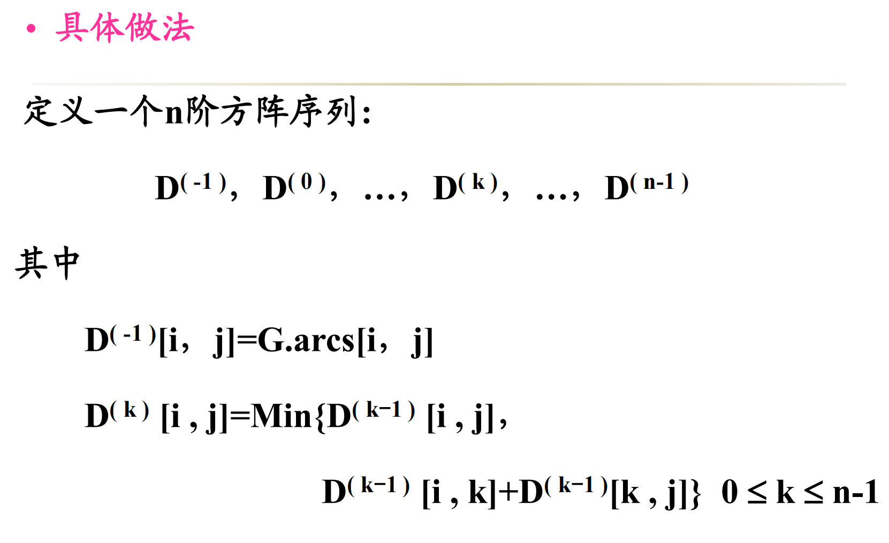
其中，
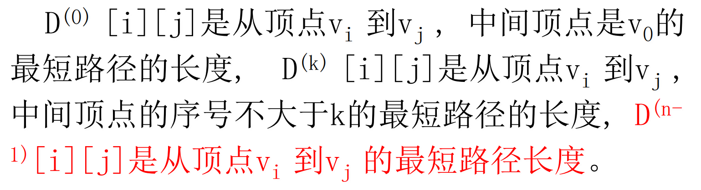

### AOE网络：带权有向无环图
顶点：时间
边上的权：两个事件发生之间的时间间隔/活动间隔时长
关键路径：从源点到汇点的最长路径长度
关键路径上的活动为关键活动，不能拖延关键活动，否则整个路径上完成的总时长会受到影响
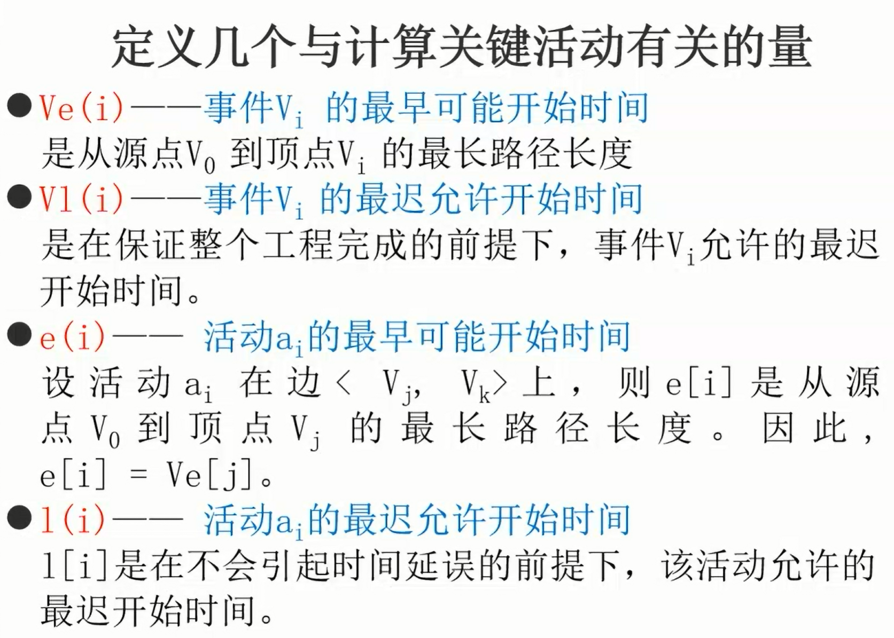
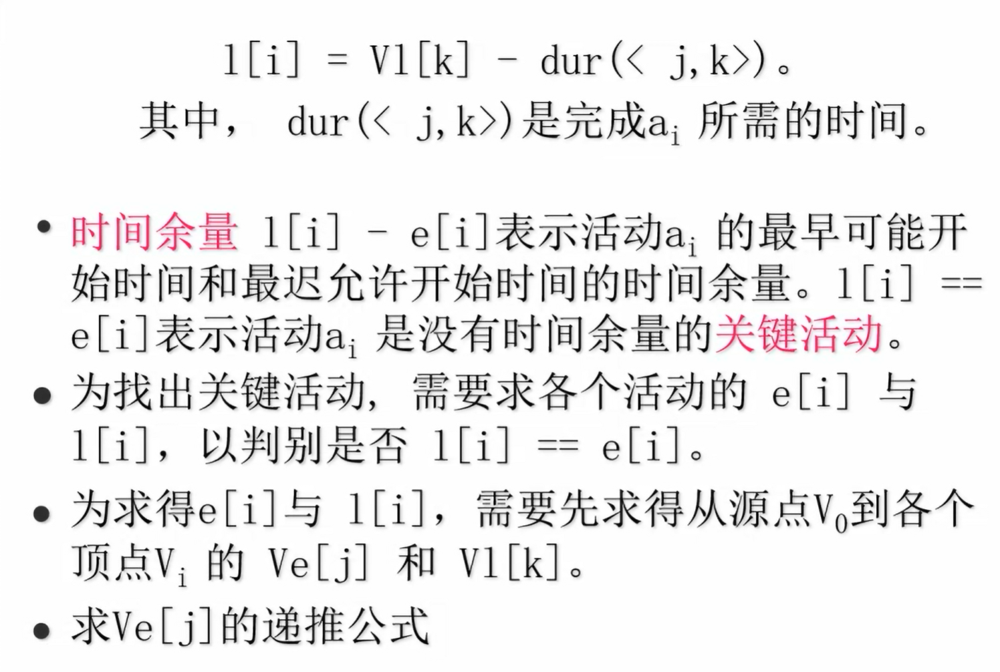

对于非关键活动，e(i) l(i)可能会有重叠
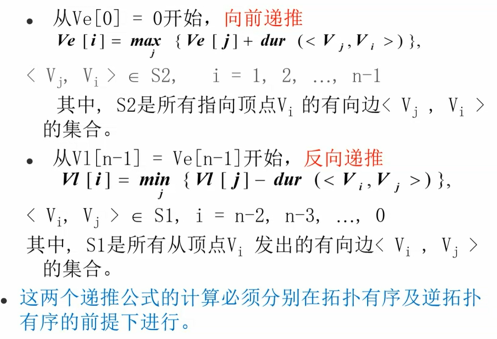
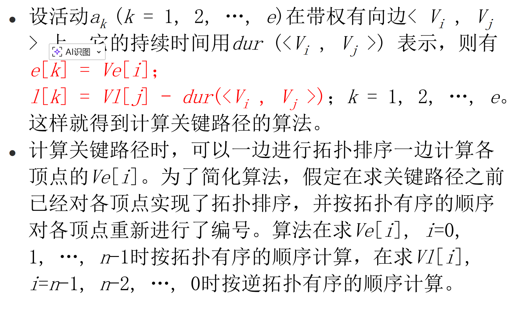
利用关键路径法求AOE网的各关键活动：
```cpp
//邻接表法：
struct ArcNode //边节点
{
    int adjvex; //与边关联的另一顶点的顶点下标
    ArcNode* next; //指向下一条弧的指针
    EdgeType info; //边权值
};

struct VNode2
{
    VertexType data; //存储顶点信息
    ArcNode *first; //指向第一条边的指针
    int indegree; //在拓扑排序中的入度
};

struct ALGraph //图
{
    VNode2 AdjList[MAX_VERTEX_NUM]; //邻接表
    int vexnum,arcnum; //图当前的顶点数与边数
};
void CriticalPath(ALGraph G)
{
    VNode2* Ve=new VNode2[G.vexnum];
    VNode2* Vl=new VNode2[G.vexnum];

    for(int i=0;i<G.vexnum;i++)
        Ve[i].data=0;
    for(int i=0;i<G.vexnum;i++)
    {
        ArcNode *p=G.AdjList[i].first;
        while(p!=NULL)
        {
            int k=p->adjvex;
            if(Ve[i].data+p->info>Ve[k].data)
                Ve[k].data=Ve[i].data+p->info;
            p=p->next;
        }
    }
    //对每个顶点的Vl初始化为汇点发生的最早时间
    for(int i=0;i<G.vexnum;i++)
        Vl[i].data=Ve[G.vexnum-1].data;
    for(int i=G.vexnum-2;i>0;i--)
    {
        ArcNode *p=G.AdjList[i].first;
        while(p!=NULL)
        {
            int k=p->adjvex;
            if(Vl[i].data>Vl[k].data-p->info)
                Vl[i].data=Vl[k].data-p->info;
            p=p->next;
        }
    }
    for(int i=0;i<G.vexnum;i++)
    {
        ArcNode *p=G.AdjList[i].first;
        while(p!=NULL)
        {
            int k=p->adjvex;
            int e=Ve[i].data;
            int l=Vl[k].data-p->info;
            if(e==l)
            //cout<<...
            p=p->next;
        }
    }
}
```

