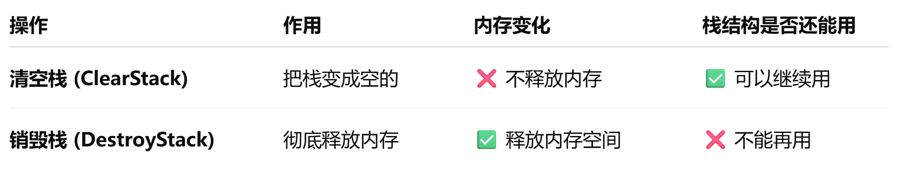

## 顺序栈
1. 销毁和清空
   
---
2. 函数指针：指向函数的入口地址，可以通过它来调用函数
    **1. 语法：**  
    ```cpp
    int (*p)(int, int);  // p 是一个指向接收两个 int 参数、返回 int 的函数指针
    ```
    **2. 赋值方式**

    函数名在表达式中**会自动转换为函数指针**，所以可以直接赋值：
    
    ```cpp
    int add(int a, int b) { return a + b; }
    
    int (*p)(int, int);  // 声明
    p = add;             // ✅ 等价于 p = &add;
    ```
    
    **3. 调用方式**
    ```cpp
    p(2, 3);     // ✅ 通过指针调用函数
    (*p)(2, 3);  // ✅ 等价写法
    add(2, 3);   // ✅ 直接调用
    ```
    三者效果相同。


    **4. 作为函数参数传递（常见用法）**

    可以把函数指针作为参数传给另一个函数，让其内部根据需要调用。
    
    示例：
    ```cpp
    #include <iostream>
    using namespace std;
    
    int PrintElem(int e) {
        cout << e << " ";
        return 1;
    }
    
    int StackTraverse(int arr[], int n, int (*visit)(int)) {
        for (int i = 0; i < n; i++)
            visit(arr[i]);  // 调用传入的函数指针
        return 1;
    }
    
    int main() {
        int a[] = {1, 2, 3, 4, 5};
        StackTraverse(a, 5, PrintElem); // ✅ 传入函数名（自动转为函数指针）
        return 0;
    }
    ```
---

