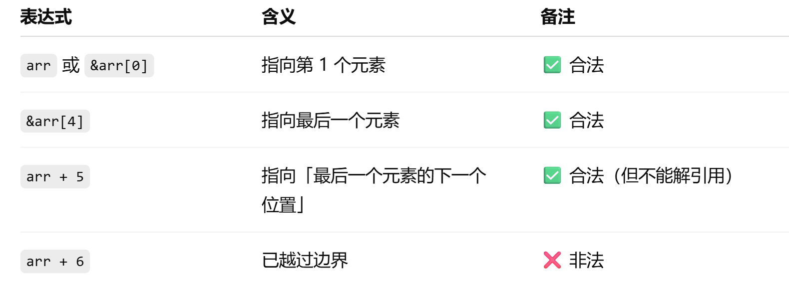
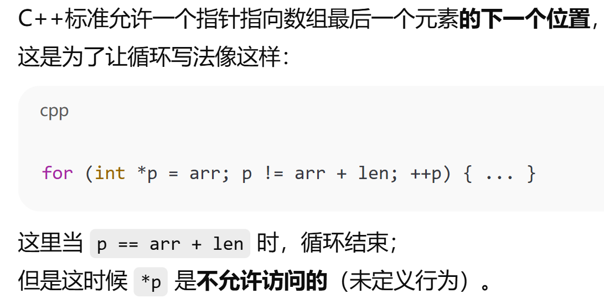
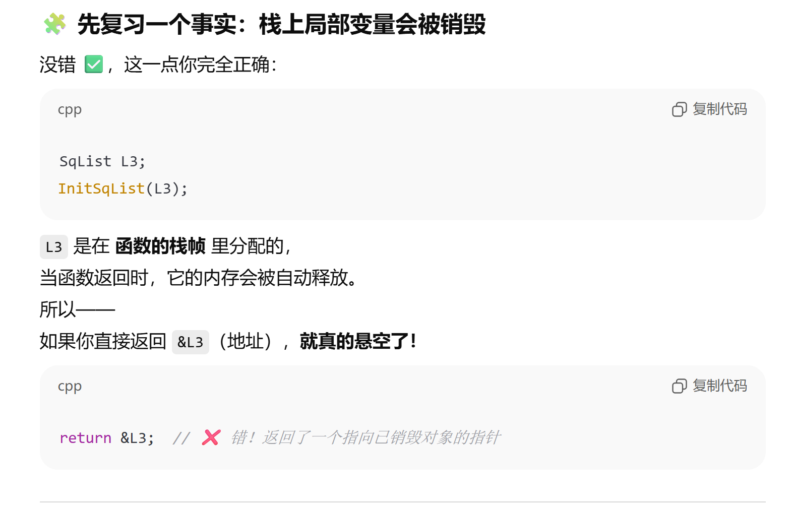
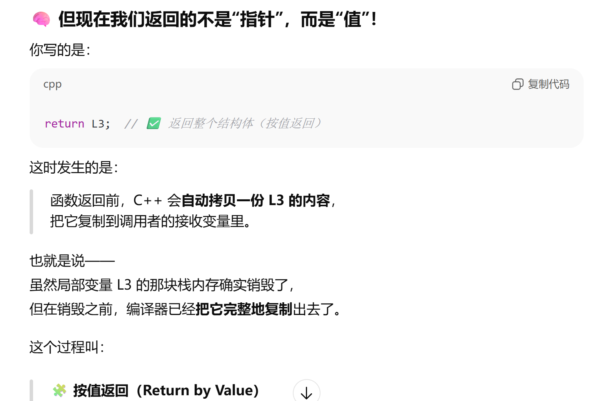
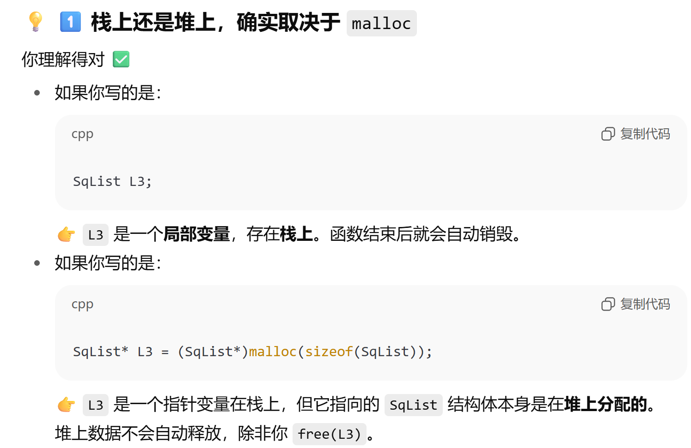
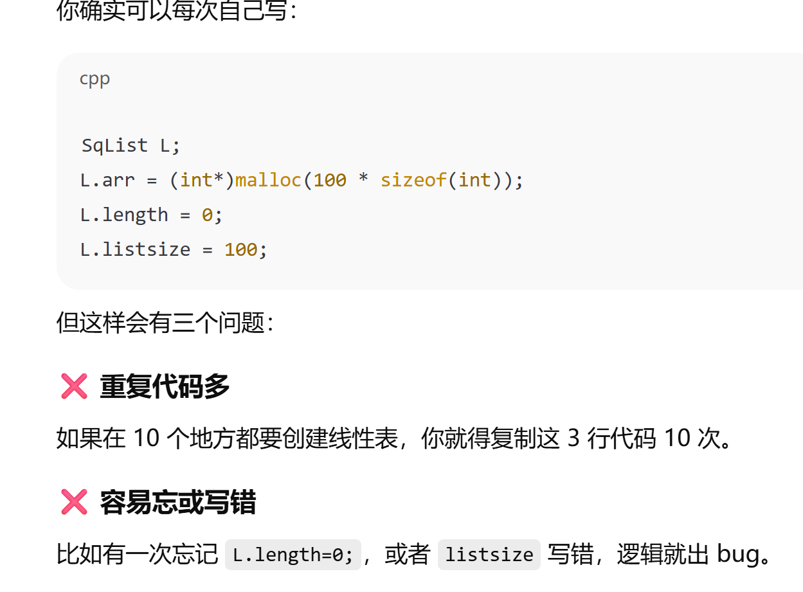
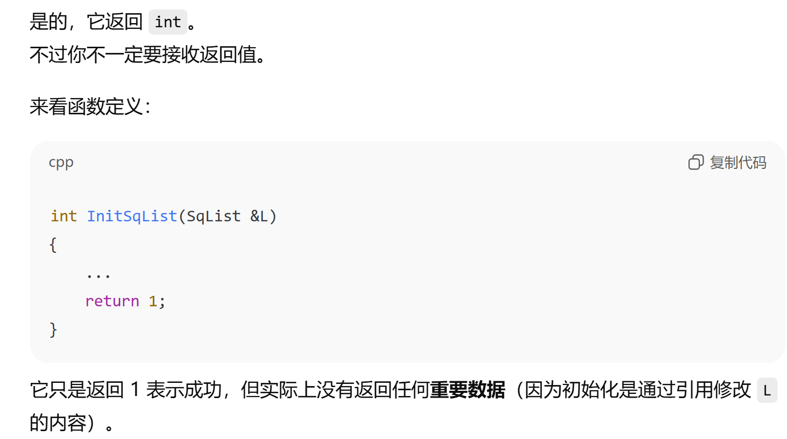

## 数组：线性表的顺序结构

### 一些一直搞不懂的点




---

注意while循环条件，不要解引用跳出范围的指针
注意插入删除操作中length的修改

---
 
**函数中指针和值的返回**
```cpp
栈：                            堆：
┌──────────────┐             ┌───────────────────┐
│ SqList L     │             │ int[LIST_INT_SIZE]│
│  arr ────────────────▶     │                   │
│  length = 0 │             │                   │
│  listsize   │             └───────────────────┘
└──────────────┘

```




---

**为什么要写 InitSqList()，而不是直接 malloc？**
封装初始化流程，避免重复和潜在错误。



---

**那个 InitSqList(\*L3) 不是应该有返回值吗？**



---

**不同 Merge 设计方式**
1. 返回值是结构体（推荐学习用）
```cpp
SqList ListMerge(const SqList& L1, const SqList& L2)
{
    SqList L3;
    InitSqList(L3);
    // ... 合并逻辑 ...
    return L3;  // 按值返回副本，自动拷贝，不会悬空
}
```
L3 在栈上创建,返回时 C++ 自动复制一份,不需要手动 malloc 或 free。

2. 返回值是指针（常见于动态管理）
```cpp
SqList* ListMerge(const SqList& L1, const SqList& L2)
{
    SqList* L3 = (SqList*)malloc(sizeof(SqList)); // 在堆上创建整个结构体
    InitSqList(*L3);  // 给内部数组分配空间
    // ... 合并逻辑 ...
    return L3;  // 外部必须手动 free(L3->arr) 和 free(L3)
}
```
适用于需要动态分配、生命周期长的场合。要记得释放，否则会内存泄漏。

3. L3 作为引用参数传入（高效）
```cpp
void ListMerge(const SqList& L1, const SqList& L2, SqList& L3)
{
    InitSqList(L3);
    // ... 合并逻辑 ...
}
```
不返回值，而是直接修改外部传入的 L3。没有额外拷贝，也不需要 malloc L3。课本中最常见

---
InitSqList(L3); 只是在堆上给 L3.arr 分配了一块存储空间，并设置了初始长度和容量。