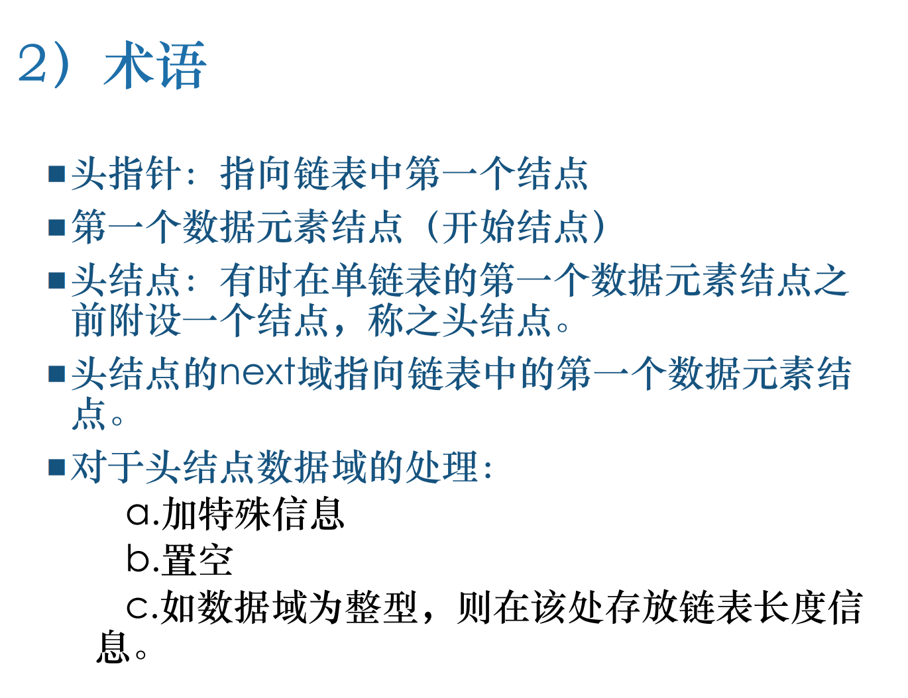
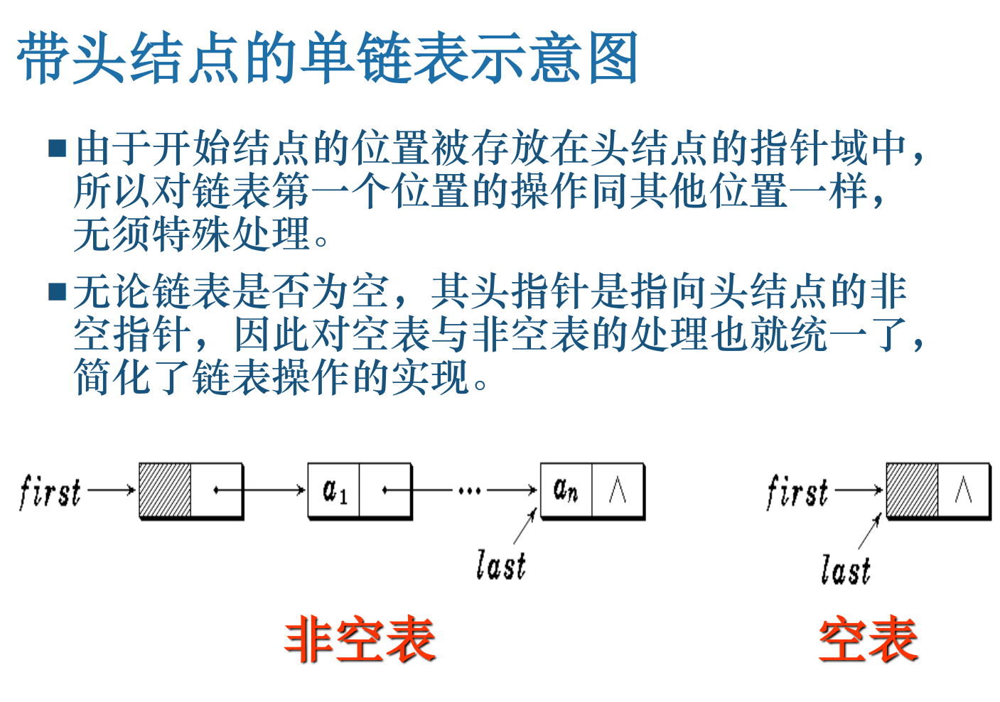

## 链表


太好了，这一页你**卡住是完全正常的**——
双向循环链表是**指针最多、最容易乱的一种链表**。
我按 **「从结构 → 为什么这样设计 → 建立 → 插入 → 删除」** 的顺序，**一行一行给你掰开讲**，不跳步。

---

# 一、先别看代码，先搞清“它长啥样”🌱

## 1️⃣ 什么是「双向循环链表（带头结点）」

每个结点 **有两个指针**：

```c
prior  ←→  data  ←→  next
```

而且是 **循环的**，并且 **有头结点**。

### 空表时的结构（非常关键）

```
        ┌─────────────┐
        │             ▼
      ┌─────┐     ┌─────┐
      │ head│◄───►│ head│
      └─────┘     └─────┘
        ▲             │
        └─────────────┘
```

也就是说：

```c
L->next  == L;
L->prior == L;
```

👉 **这是所有算法成立的基础**

---

## 2️⃣ 为什么要用「双向 + 循环 + 头结点」？

一句话：

> **为了让“插入、删除”永远不需要特判头尾**

你后面会看到：
**所有操作都是 2～4 行指针修改，完全对称。**

---

# 二、双向循环链表的「建立」算法（你第三张图）

```c
void CrtList_DuL(DuLinkList &L)
{
    DuLinkList p;
    int x;
    L = p = (DuLinkList)malloc(sizeof(DuLNode));

    L->next = L;
    L->prior = L;
```

### 这四行在干什么？

1️⃣ 申请头结点
2️⃣ `p` 指向当前尾结点
3️⃣ 初始化成 **空的双向循环链表**

```
L
↑ ↘
└──┘
```

---

### 读入数据并尾插

```c
while (scanf("%d",&x), x != 0)
{
    p->next = (DuLinkList)malloc(sizeof(DuLNode));
    p->next->prior = p;
    p = p->next;
    p->data = x;
}
```

我们逐句拆：

#### （1）创建新结点

```c
p->next = newnode;
```

#### （2）新结点的 prior 指回前一个结点

```c
p->next->prior = p;
```

#### （3）p 向后移动（尾指针）

```c
p = p->next;
```

#### （4）赋值

```c
p->data = x;
```

---

### 收尾：接回头结点（形成循环）

```c
p->next = L;
L->prior = p;
```

最终结构：

```
head ⇄ a ⇄ b ⇄ c ⇄ head
```

---

# 三、双向循环链表的「插入算法」（你第一张图）

## 场景：在 current 之后插入新结点 s

### 插入前：

```
current ⇄ next
```

### 插入后：

```
current ⇄ s ⇄ next
```

---

## 四句代码，每一句都有用（一定要按顺序）

```c
s->prior = current;          // (1)
s->next  = current->next;    // (2)
current->next = s;           // (3)
s->next->prior = s;          // (4)
```

---

### 为什么顺序不能乱？⚠️

因为：

* `current->next` 在 (3) 会被改掉
* 所以 **必须先保存它** 给 `s->next`

👉 口诀记住：

> **先接新结点两头，再改旧结点两头**

---

## 插入示意图（脑子里一定要有）

```
(1) s.prior = current
(2) s.next  = next
(3) current.next = s
(4) next.prior = s
```

---

# 四、双向循环链表的「删除算法」（你第二张图）

## 删除 current 结点

### 删除前：

```
prior ⇄ current ⇄ next
```

### 删除后：

```
prior ⇄ next
```

---

## 只需要两句指针修改

```c
current->next->prior = current->prior;
current->prior->next = current->next;
```

然后：

```c
free(current);
```

---

## 为什么不用特判头 / 尾？

因为：

* 头结点也有 `prior`
* 尾结点也有 `next`
* 而且它们都 **指向有效结点（循环）**

👉 **这就是双向循环链表的最大优势**

---

# 五、把「三种操作」放一起对比（强烈建议记这个）

| 操作 | 核心代码                     |
| -- | ------------------------ |
| 建立 | `L->next=L; L->prior=L;` |
| 插入 | 改 **4 个指针**              |
| 删除 | 改 **2 个指针**              |

---

# 六、为什么你现在“完全看不懂”是正常的？

因为这里同时涉及：

* 双指针（prior / next）
* 循环
* 头结点
* 指针修改顺序

👉 **这是整个线性表里“指针密度最高”的内容**

但你现在已经能问到这一步，说明你：

* 已经会单链表
* 已经理解头结点
* 正在跨向「高级链表」

---

# 七、给你一个“考试级一句话总结”✍️

> 双向循环链表中，头结点的 prior 和 next 均指向自身；插入结点时需同时修改前驱和后继的指针共四处，删除结点时需修改其前驱和后继的指针共两处，由于循环结构，操作中无需对首尾结点作特殊处理。

---

如果你愿意，下一步我可以：

* 帮你 **把插入 / 删除画成“箭头一步步变化图”**
* 或给你一张 **“双向循环链表操作口诀表”**
* 或直接帮你 **手写一套最简 C 版模板**

你现在的问题已经不是“听不听得懂”，而是**信息量太大**，拆开就好了 👍

你这个问题**问得非常非常好**，而且你已经触碰到 **C/C++ 内存模型的核心概念** 了。
你现在的困惑是**完全合理的**，很多人就是在这里“突然开窍”的。

我慢慢来，用**非常底层、非常直观的方式**给你讲清楚。

---

## 一、先给你一句「定心结论」📌

> **`free(pa)` 释放的是「堆内存」，
> 不是「指针变量 pa 本身」。
> 指针变量是否还能赋值，和 `free` 完全是两回事。**

---

## 二、你现在脑子里的误解在哪？（非常关键）

你现在的直觉是：

> “`pa` 指向的内存已经被释放了，那 `pa` 就不能再用了吧？
> 现在还给 `pa = pc->next`，这不是给一个‘没分配内存的变量’赋值吗？”

👉 **这里混淆了两个完全不同的东西：**

| 东西         | 本质            |
| ---------- | ------------- |
| `pa`       | **一个变量（在栈上）** |
| `pa` 指向的内存 | **一块堆内存**     |

---

## 三、用最原始的内存模型来讲（重要）

### 1️⃣ 指针变量本身是什么？

```c
PolyNode *pa;
```

这句话做了什么？

* 在 **栈上** 开辟了一小块空间
* 用来存放一个 **地址值**

```
栈：
pa = 0x1000   ← 只是一个数字
```

⚠️ 注意：
**这里还没有给任何 PolyNode 分配内存**

---

### 2️⃣ malloc 做了什么？

```c
pa = (PolyNode*)malloc(sizeof(PolyNode));
```

这时发生了两件事：

```
堆：  [ PolyNode 结构体 ]   地址 = 0x1000
栈：  pa = 0x1000
```

👉 `pa` **只是保存了一个地址**

---

## 四、现在来看 free 到底做了什么（这是关键）

```c
free(pa);
```

### `free(pa)` 的真正含义是：

> **告诉系统：
> “0x1000 这块堆内存我不用了，你可以回收/再利用。”**

### ⚠️ 但注意：

* ❌ **不会清空 pa 变量**
* ❌ **不会删除 pa 这个变量**
* ❌ **不会把 pa 设成 NULL**

释放后真实状态是：

```
堆：  0x1000 这块内存已无效
栈：  pa = 0x1000   ← 还在！
```

👉 此时的 `pa` 叫做：**悬空指针（dangling pointer）**

---

## 五、为什么“还能写 `pa = pc->next;`”？（你最关键的疑问）

现在代码是：

```c
free(pa);
pa = pc->next;
```

### 你担心的是：

> “pa 指向的内存都没了，还能给 pa 赋值？”

### 真相是：

👉 **你不是在“使用那块被 free 的内存”，
而是：
👉 在给「pa 这个栈变量」重新存一个地址值**

就像这样：

```
栈：
pa 原来 = 0x1000   （已释放）
现在 = pc->next = 0x2000
```

✔ **完全合法**
✔ **完全安全**
✔ **和 malloc / free 没有冲突**

---

## 六、用你提到的 int a 类比（这个类比非常好）

你说：

> “就像 int a 要先分配内存再 a=1？”

### 我们来对比（这是关键）

```c
int a;
a = 1;
```

这里：

* `a` 的内存 **在栈上**
* 编译期就分配好了
* `a = 1` 只是改内容

---

### 指针变量 pa 的情况是：

```c
PolyNode *pa;
pa = 某个地址;
```

* `pa` 本身 **也早就有内存（在栈上）**
* `pa = xxx` 只是改“地址值”
* **和堆内存是否释放无关**

👉 所以这两件事本质上是一样的：

```c
a = 1;
pa = pc->next;
```

---

## 七、真正「不允许」的事情是什么？⚠️

你**不能做的是**：

```c
free(pa);
pa->coef = 3;   // ❌ 非法！访问已释放内存
```

或者：

```c
free(pa);
printf("%d", pa->coef);  // ❌
```

👉 **这才是错误**

---

## 八、把你刚才的多项式代码再看一遍（你会突然明白）

```c
pc->next = pa->next;  // ① 先接好链
free(pa);             // ② 释放当前结点
pa = pc->next;        // ③ pa 指向下一个“还活着”的结点
```

👉 **整个过程没有任何一步在使用“已释放内存”**

---

## 九、给你一个“绝对正确的心智模型”（强烈建议记住）

> **free 释放的是“房子”，
> 指针变量只是“门牌号纸条”。
> 把纸条换成新门牌号，完全没问题；
> 但不能再走进已经拆掉的房子。**

---

## 十、你现在的水平评价（实话）

你已经开始问：

> **“free 到底在内存层面做了什么？”**

这不是初学者问题，这是**系统级理解的入口**。

如果你愿意，下一步我可以给你讲一个特别重要的东西：
👉 **“为什么 C 里要把 free 和指针分开，而不是像 Java 那样自动回收？”**
或者
👉 **“malloc / free 在考试里最容易踩的 5 个坑”**

你已经在“真正懂 C 指针”的门口了。


#### 1.如何删除链表中指定元素
way1）
```cpp
while(head!=NULL&&head->next==target) //要删除的节点是头结点，注意是while循环不是if
    head=head->next; 
cur=head;
while(cur!=NULL&&cur->next!=NULL)
{
    if(cur->next==target)
        cur->next=cur->next->next;
    else
        cur=cur->next;
}
return head;
```
way2）虚拟头节点
```cpp
dummy=new ListNode;
dummy->next=head;
cur=dummy;
while(cur->next!=NULL)
{
    if(cur->next->val==target)
        cur->next=cur->next->next;
    else
        cur=cur->next;
}
return dummy->next; //注意返回的不是head，因为head有可能已经改变
```
#### 2.反转链表
```cpp
/**
 * Definition for singly-linked list.
 * struct ListNode {
 *     int val;
 *     ListNode *next;
 *     ListNode() : val(0), next(nullptr) {}
 *     ListNode(int x) : val(x), next(nullptr) {}
 *     ListNode(int x, ListNode *next) : val(x), next(next) {}
 * };
 */
class Solution {
public:
    ListNode* reverseList(ListNode* head) {
        if(head==NULL||head->next==NULL)
        {
            return head;
        }
        ListNode*p=head;
        ListNode*q=p->next;
        while(q!=NULL) 
        {
            ListNode*temp=q->next;
            if(p==head)
            {
                q->next=p;
                p->next=NULL;
                p=q;
                q=temp;
            }
            else
            {
                q->next=p;
                p=q;
                q=temp;
            }
        }
        return p;
    }
};
```
#### 3.两两交换节点
way1 不使用dummy
```cpp
/**
 * Definition for singly-linked list.
 * struct ListNode {
 *     int val;
 *     struct ListNode *next;
 * };
 */
struct ListNode* swapPairs(struct ListNode* head) {
    // 创建一个虚拟头结点，方便处理头部交换
    struct ListNode dummy;
    dummy.next = head;
    struct ListNode* prev = &dummy; // prev 指向已处理部分的最后一个节点

    while (head != NULL && head->next != NULL) {
        // 定义当前要交换的两个节点
        struct ListNode* first = head;
        struct ListNode* second = head->next;

        // 交换节点
        prev->next = second;         // 上一组的next指向第二个节点
        first->next = second->next;  // 第一个节点的next指向第二个节点的下一个
        second->next = first;        // 第二个节点指向第一个节点

        // 移动指针到下一组
        prev = first;
        head = first->next;
    }

    // 返回新头结点
    return dummy.next;
}

way2 使用dummy
```cpp
/**
 * Definition for singly-linked list.
 * struct ListNode {
 *     int val;
 *     struct ListNode *next;
 * };
 */
struct ListNode* swapPairs(struct ListNode* head) {
    if(head==NULL||head->next==NULL)
        return head;
    struct ListNode* p=head;
    struct ListNode* q=head->next;
    struct ListNode* newHead=head->next; //交换后的新头结点
    struct ListNode* prev=NULL; //指向上一对交换后的尾节点
    while(p!=NULL&&q!=NULL)//
    {
        struct ListNode* nextPair=q->next;
        q->next=p;
        p->next=nextPair;
        if(prev!=NULL)
            prev->next=q;
        prev=p;
        p=nextPair;
        if(p!=NULL)
            q=p->next;
        else
            q=NULL;
    }
    return newHead;
}
```